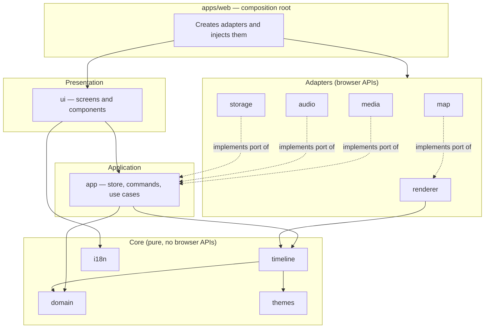
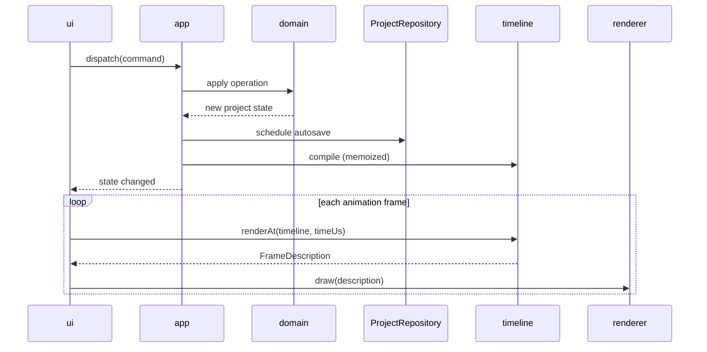

# Application Architecture

English | [繁體中文](zh-TW/architecture.md)

| | |
|---|---|
| Version | 0.1 (draft) |
| Date | 2026-10-20 |
| Status | Design. Governs all product code; see [ADR 0005](adr/0005-modular-architecture.md). |

## 1. Goals

- **Replaceable parts.** Any module — the map renderer, storage, the UI framework, a theme — can be rewritten or swapped without touching unrelated code.
- **Testable core.** Everything that decides *what* appears on screen is pure TypeScript that runs without a browser.
- **Ready for later releases.** MP4 export and installed builds ([1.0 Definition §4.3](release-1.0.md#43-after-10)) are added as new modules, not by redesigning existing ones.

## 2. Layers



| Layer | Rule |
|---|---|
| Core | Pure functions and data. No DOM, no network, no storage, no timers. Fully covered by unit tests. |
| Application | Holds state and orchestrates use cases. Talks to the outside world only through **ports** (TypeScript interfaces it defines). No DOM. |
| Adapters | Implement ports using browser APIs (Canvas, WebGL, IndexedDB, OPFS, Web Audio, File System Access). One adapter per technology. |
| Presentation | Renders state and dispatches commands. Never calls storage, media or map code directly. |
| Shell | The only place that knows every concrete implementation. Creates adapters, injects them into the application, mounts the UI, registers the service worker. |

## 3. Packages

| Package | Responsibility | May depend on |
|---|---|---|
| `domain` | Entities (Trip, Stop, Asset, Clip, MusicTrack), invariants, and pure operations such as reorder, assign and trim | — |
| `themes` | Theme definitions as data: colors, typography, layout rules for 16:9 and 9:16 | — |
| `i18n` | Locale resolution and message catalogs (exists) | — |
| `timeline` | `compile(project, settings)` → immutable Timeline; `renderAt(timeline, timeUs)` → **FrameDescription** | `domain`, `themes` |
| `app` | Store, commands with undo and redo, autosave scheduling, use cases (import, match, back up, restore); defines the ports below | `domain`, `timeline` |
| `renderer` | Draws a FrameDescription onto a canvas; defines the `MapLayer` and `MediaSource` ports | `timeline` |
| `map` | `MapLayer` implementation on the chosen map engine, reading downloaded map files from the device; region downloads; place-name search in the downloaded maps; implements `PlaceSearch` ([ADR 0006](adr/0006-local-only-operation.md)) | `renderer`, `app` |
| `media` | File import, metadata (capture time, GPS), thumbnails and proxies, stop-matching suggestions; implements `MediaPort` | `domain`, `app` |
| `audio` | Preview mixing with Web Audio: music, fades, ducking; implements `AudioPort` | `timeline`, `app` |
| `storage` | IndexedDB and OPFS persistence, project package backup and restore; implements `ProjectRepository` and `AssetStore` | `domain`, `app` |
| `ui` | Screens and components (trip list, workspace, dialogs, player) | `app`, `i18n`, `themes` |
| `apps/web` | Composition root and PWA shell | all |
| `apps/android` | Android shell (Capacitor): packages the build of `apps/web` and saves backups through its `SaveFile` plugin ([ADR 0008](adr/0008-android-in-1-0.md)) | — |

Later releases add packages without changing these: `export` (encodes frames from `renderer`), an offline implementation inside `map`, and platform shells under `apps/`.

## 4. Key Contracts

### 4.1 FrameDescription

`renderAt` does not draw. It returns a plain object describing the frame:

```ts
interface FrameDescription {
  readonly timeUs: number;
  readonly segmentIndex: number;                          // segment at this time
  readonly segmentKind: Segment["kind"];
  readonly camera: { readonly center: LonLat; readonly zoom: number; readonly bearing: number };
  readonly route: { readonly progress: number };          // stops reached, fractional while travelling
  readonly markers: readonly MarkerState[];               // visited, current, upcoming
  readonly overlays: readonly Overlay[];                  // titles, captions, media cards, attribution
  readonly audio: readonly AudioState[];                  // clip sound and music, with gains
  readonly fade: number;                                  // 0–1, used by reduced motion
}
```

The full definition and its design decisions are in [`packages/timeline`](../packages/timeline/src/frame.ts) and the [S2 report](spikes/s2-timeline-compiler.md).

Because the frame is data, the same description drives the preview, the full-screen player and, later, export; and the drawing technology can change without touching the timeline. Determinism is tested by comparing descriptions, not pixels.

### 4.2 Ports

| Port | Defined in | 1.0 implementation | Later |
|---|---|---|---|
| `ProjectRepository` — load, save with revision check, list, delete | `app` | `storage` (IndexedDB) | SQLite in installed builds |
| `AssetStore` — put, get, remove media files | `app` | `storage` (OPFS) | Native file system |
| `MediaPort` — read metadata, create thumbnails and proxies | `app` | `media` (browser decoders) | Native decoders |
| `AudioPort` — play, pause, seek the mixed preview | `app` | `audio` (Web Audio) | — |
| `MapLayer` — draw the base map for a camera | `renderer` | `map` (downloaded PMTiles) | Native map rendering |
| `PlaceSearch` — find place names in the downloaded maps | `app` | `map` (place-name index) | — |
| `MapRegions` — plan, download, verify and remove map regions | `app` | `map` (Overture Maps) | — |
| `RegionRepository` — store the list of downloaded regions | `app` | `storage` (IndexedDB) | SQLite in installed builds |
| `MediaSource` — provide a decoded frame for a clip at a time | `renderer` | `media` | Export decoder |
| `Clock` — current time and frame scheduling | `app` | `requestAnimationFrame` | Fixed-step clock for export |
| `Scheduler` — run a callback after a delay, for autosave | `app` | `setTimeout` | — |

Tests replace every port with an in-memory fake.

### 4.3 Data flow



State flows in one direction. Commands are the only way to change state, which gives undo and redo for free and makes every user action testable without a UI.

## 5. Rules

1. **Dependencies point inward only.** Core depends on nothing; adapters and presentation depend on core and application, never the reverse. Circular dependencies are not allowed.
2. **Public API through the package entry point only.** No imports from another package's internal files.
3. **One responsibility per file.** As a guideline, a file stays under 300 lines; a longer file is a signal to split it.
4. **Browser APIs only in adapters and the shell.** Core and application code must run in Node.js tests.
5. **No global state.** Dependencies are passed in by the shell, not imported as singletons.
6. **New technology behind a port.** Adding a third-party library that touches the browser, the network or storage requires a port, so that it can be replaced.

Rules 1 and 2 are enforced by `pnpm run deps:check`, part of `pnpm run verify`, using the allowed dependencies in [`tools/deps-check/boundaries.json`](../tools/deps-check/boundaries.json). Rule 4 is enforced by type checking: the shared TypeScript configuration does not include DOM types, so core and application code cannot reference browser APIs. Adapter packages are listed in `tsconfig.browser.json`, which adds the DOM types for them only.

## 6. Testing per Layer

| Layer | Approach |
|---|---|
| Core | Unit tests; property tests for the timeline (monotonic time, determinism, Date Line handling) |
| Application | Unit tests with fake ports; command and undo sequences |
| Adapters | Integration tests in a real browser |
| Presentation | Component tests; accessibility checks |
| End to end | The core scenario of the [1.0 Definition §2](release-1.0.md#2-target-users-and-core-scenario) in a real browser |

## 7. Technology Choices

| Concern | Choice | Notes |
|---|---|---|
| UI framework | React | Confined to `ui` and `apps/web` |
| State | A small store in `app` on `useSyncExternalStore` | No state library dependency |
| Styling | CSS Modules | Built into the bundler; design tokens shared through CSS custom properties |
| Map engine | Decided in spike S1 | Used only inside `map` |
| Bundler and dev server | Vite | Development tool |

All runtime libraries remain subject to the [Dependency License Policy](license-policy.md).
