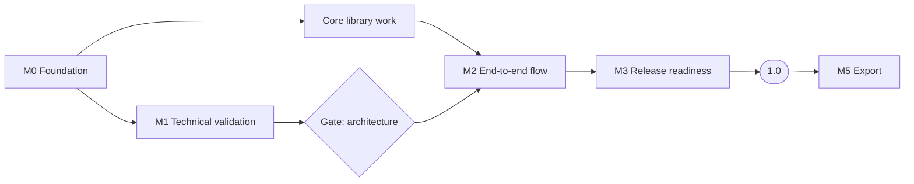

# Roadmap

English | [繁體中文](zh-TW/roadmap.md)

| | |
|---|---|
| Version | 0.1 (draft) |
| Date | 2026-10-19 |
| Status | Planning. No milestone has started. |

This roadmap breaks the development phases in the [Specification §10](specification.md#10-development-phases-and-decision-gates) into milestones with explicit exit criteria, leading to the release defined in the [1.0 Definition](release-1.0.md). No dates are committed; each milestone starts when its predecessors' exit criteria are met.

## Overview

Milestones M0 to M3 lead to 1.0, which delivers the on-screen experience entirely on the device. M5 forms the next release ([1.0 Definition §4.3](release-1.0.md#43-after-10)). The former M4 (offline) is part of M2 ([ADR 0006](adr/0006-local-only-operation.md)).

## M0 — Foundation

Prerequisite for adding any dependency.

| ID | Task | Exit criteria |
|---|---|---|
| M0.1 | Decide the license scope (see [License Feasibility Assessment](license-assessment.md)) | **Done.** Option C adopted ([ADR 0001](adr/0001-dependency-license-scope.md)) |
| M0.2 | Choose the primary language and toolchain consistent with M0.1 | **Done.** [ADR 0003](adr/0003-language-and-toolchain.md) |
| M0.3 | Repository governance: contributing guide, code of conduct, security policy, issue and pull request templates | Documents merged; private vulnerability reporting enabled in repository settings |
| M0.4 | CI license gate: reject unknown, prohibited or unreviewed licenses in lockfiles | **Done.** Verified to reject an unreviewed package and a reviewed MPL-2.0 package ([Development Guide](development.md#license-check)) |
| M0.5 | CI baseline: lint, format and unit test jobs on every pull request | **Done.** Local verification (`verify`, `verify:clean`, Git hooks) and CI on every pull request and push to `main` |
| M0.6 | Localization scaffolding (see [Localization](localization.md)) | **Done.** `packages/i18n` loads `en` and `zh-TW` catalogs; `i18n:check` rejects missing keys and mismatched arguments |
| M0.7 | Public release of the repository | See below |

### M0.7 — Making the repository public

The repository remains private until the project is ready for outside contributors. Before changing its visibility:

1. ~~Review the full Git history for files and content that must not be published.~~ Done.
2. ~~Restore the `pull_request` and `push` triggers in `.github/workflows/ci.yml`, and confirm that the first run passes.~~ Done.
3. Require the CI check on `main` in branch protection settings.
4. Enable private vulnerability reporting.
5. Confirm that README, contributing guide and policies are complete in both languages.

## M1 — Technical Validation (Phase A)

Each spike produces a short report in `docs/spikes/` and a throwaway prototype. Prototypes are not merged into the product code base, except where a spike concludes that its prototype already meets product standards, as for S2.

| ID | Spike | Questions to answer | Exit criteria |
|---|---|---|---|
| S1 | Map rendering and data | Which renderer is admissible under M0.1? Which map files can be downloaded by region, and can they be read by range from the device? How are place names searched on the device? | A license-compliant renderer draws an OpenStreetMap vector base map from a file on the device, with Traditional Chinese labels, at 30 fps on the reference devices; place-name search on the downloaded map measured. **Done.** Renderer, tile format and labels ([report](spikes/s1-map-rendering.md)); Overture Maps verified as the download source (CORS, range reads, region sizes, names); on-device place search measured; 30 fps at 1080p on three devices |
| S2 | Timeline compiler | Is `renderAt(timeUs)` deterministic for a fixed timeline? | **Done.** Two runs at identical timestamps yield identical camera, captions and media state; Date Line and identical-coordinate cases covered by tests ([report](spikes/s2-timeline-compiler.md)) |
| S6 | Web storage | Can OPFS and IndexedDB hold 10 GB of media with crash-safe imports? | **Done.** Forced termination during import leaves no referenced partial files in Chromium; the import features work in Chromium, Android System WebView and WebKit; quota can be as low as 1 GB; Firefox follows in M2 ([report](spikes/s6-web-storage.md)) |

Spike S3 (Web export) moves to M5. Spikes S4 (installed shell) and S5 (mobile media bridge) are deferred until the installed builds ([ADR 0004](adr/0004-web-first-release.md)).

**Gate — architecture decision.** After S1, S2 and S6, fix the renderer, the map pipeline and the supported browser versions for M2. Also choose the map download source ([ADR 0006](adr/0006-local-only-operation.md)). The renderer must be driven by `renderAt(timeUs)` and must read maps only from files on the device, so that M5 can be added without redesign. **Decided** in [ADR 0007](adr/0007-architecture-gate.md).

## Core Library Work

The following can start once M0.1 and M0.2 are complete, in parallel with M1, because it has no platform or map dependency:

Packages follow the [Application Architecture](architecture.md):

- **Done.** Dependency check for the package boundaries (`pnpm run deps:check`).
- **Done.** Domain model, invariants and editing operations (`domain`) and built-in theme definitions (`themes`).
- **Done.** Timeline compiler and `renderAt` returning a FrameDescription (`timeline`), accepted from spike S2.
- **Done.** Store, commands with undo and redo, autosave with revision checks, and the persistence ports (`app`). The media, audio and clock ports are added with their adapters.
- **Done.** IndexedDB project repository and OPFS asset store with the import protocol and start-up recovery from spike S6 (`storage`).
- **Done.** Project package format specification ([Project Package Format](project-package.md)) and reader/writer (part of `storage`), including path-traversal and size validation.

## M2 — End-to-End Flow (Phase B)

| Exit criteria |
|---|
| Trip list, workspace (itinerary, media, music, themes, draggable timeline) and full-screen player as specified in the [Screen Design](ui-design.md), usable on every supported browser |
| Automatic media matching, background music and themes ([1.0 Definition §4.2](release-1.0.md#42-additional-features-required-in-10)) |
| Autosave with revision checks; reopening a project restores its exact state |
| Versioned project package: back up in one browser and restore in another without loss |
| Map download by region: size shown in advance, pause, resume, verification, storage display, updates and deletion; insufficient-storage handling |
| Place search on the downloaded map, pins, and pasted coordinates or map links |
| Airplane-mode acceptance test passes ([Specification §9](specification.md#9-acceptance-criteria-and-testing)); network inspection confirms no request other than loading the application and downloading maps |
| All UI strings available in `en` and `zh-TW` |

**In progress.** Done in `map`:

- the `MapLayer` port (`renderer`) and its MapLibre implementation, which draws the base map from PMTiles files on the device;
- region download from Overture Maps. Planning reads only the remote directories, so the size is known before the download. Parts are stored one by one, so a paused or interrupted download resumes with the missing parts. Parts are named after the remote version, and the stored archives are verified after download;
- place search on the device (the `PlaceSearch` port in `app`). The index is built from the downloaded `divisions`, `base` and `places` archives and stored as a compact binary file. Variant characters are folded with a table generated from OpenCC, and equivalent words such as 車站 and 駅 are unified ([spike S1 §5.4](spikes/s1-map-rendering.md#54-in-the-product)).

The region list with its states and the maps dialog follow. Map files go to their own OPFS volume, because start-up recovery of the media store removes files that no project refers to.

## M3 — Release Readiness for 1.0 (Phase E)

| Exit criteria |
|---|
| Public site deployed over HTTPS with a Content Security Policy; installable as a PWA |
| Map download source confirmed and its terms recorded; attribution shown in the map and during playback |
| Quality bar of the [1.0 Definition §6](release-1.0.md#6-quality-bar) met, including usability testing |
| Accessibility review: keyboard operation, screen-reader labels, sufficient contrast, reduced-motion option for previews |
| License release gate passes ([Dependency License Policy §6](license-policy.md#6-release-gate)) |
| User guide, privacy statement, known issues and browser support table complete in `en` and `zh-TW`; `1.0.0` tagged with a changelog |

## After 1.0

### M5 — Export (Phase D)

Starts with spike S3: can WebCodecs plus an admissible MP4 muxer produce a 30-second 1080p H.264 file with audio on Chrome, Edge, Safari and Firefox? Exit criteria for the spike: the file plays in the default players of all five desktop and mobile OS families, audio-video offset ≤ 100 ms, and export support is recorded per browser.

| Exit criteria |
|---|
| MP4 export on the supported browsers, with original audio and background music mixing, and OpenStreetMap attribution rendered into the video |
| Cancellation and recovery leave no partial output presented as complete |
| Long-video, low-storage and mixed-format test suites pass |

### Installed builds

Installed builds for Windows, macOS, Linux, Android and iOS, starting with spikes S4 and S5, followed by platform packaging, signing and store releases.
