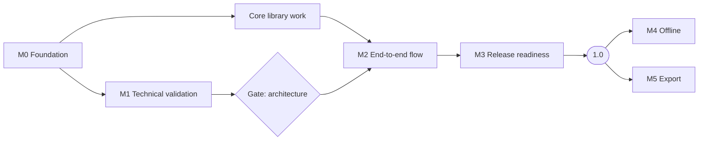

# Roadmap

English | [繁體中文](zh-TW/roadmap.md)

| | |
|---|---|
| Version | 0.1 (draft) |
| Date | 2026-10-19 |
| Status | Planning. No milestone has started. |

This roadmap breaks the development phases in the [Specification §10](specification.md#10-development-phases-and-decision-gates) into milestones with explicit exit criteria, leading to the release defined in the [1.0 Definition](release-1.0.md). No dates are committed; each milestone starts when its predecessors' exit criteria are met.

## Overview

Milestones M0 to M3 lead to 1.0, which delivers the on-screen experience. M4 and M5 form the next release ([1.0 Definition §4.3](release-1.0.md#43-after-10)).

## M0 — Foundation

Prerequisite for adding any dependency.

| ID | Task | Exit criteria |
|---|---|---|
| M0.1 | Decide the license scope (see [License Feasibility Assessment](license-assessment.md)) | **Done.** Option C adopted ([ADR 0001](adr/0001-dependency-license-scope.md)) |
| M0.2 | Choose the primary language and toolchain consistent with M0.1 | **Done.** [ADR 0003](adr/0003-language-and-toolchain.md) |
| M0.3 | Repository governance: contributing guide, code of conduct, security policy, issue and pull request templates | Documents merged; private vulnerability reporting enabled in repository settings |
| M0.4 | CI license gate: reject unknown, prohibited or unreviewed licenses in lockfiles | **Done.** Verified to reject an unreviewed package and a reviewed MPL-2.0 package ([Development Guide](development.md#license-check)) |
| M0.5 | CI baseline: lint, format and unit test jobs on every pull request | **Done.** Local verification (`verify`, `verify:clean`, Git hooks) and CI on every pull request and push to `main` |
| M0.6 | Localization scaffolding (see [Localization](localization.md)) | **Done.** `packages/i18n` loads `en` and `zh-TW` catalogs; `i18n:check` rejects missing keys and mismatched arguments |
| M0.7 | Public release of the repository | See below |

### M0.7 — Making the repository public

The repository remains private until the project is ready for outside contributors. Before changing its visibility:

1. ~~Review the full Git history for files and content that must not be published.~~ Done.
2. ~~Restore the `pull_request` and `push` triggers in `.github/workflows/ci.yml`, and confirm that the first run passes.~~ Done.
3. Require the CI check on `main` in branch protection settings.
4. Enable private vulnerability reporting.
5. Confirm that README, contributing guide and policies are complete in both languages.

## M1 — Technical Validation (Phase A)

Each spike produces a short report in `docs/spikes/` and a throwaway prototype. Prototypes are not merged into the product code base.

| ID | Spike | Questions to answer | Exit criteria |
|---|---|---|---|
| S1 | Map rendering and data | Which renderer is admissible under M0.1? How are OpenStreetMap tiles generated, hosted without request logging, and read by range into an offline package? Which place-search provider permits the intended use? | A license-compliant renderer draws a self-generated OpenStreetMap vector base map from a local file, with Traditional Chinese labels, at 30 fps on the reference devices; hosting cost estimated |
| S2 | Timeline compiler | Is `renderAt(timeUs)` deterministic for a fixed timeline? | Two runs at identical timestamps yield identical camera, captions and media state; Date Line and identical-coordinate cases covered by tests |
| S6 | Web storage | Can OPFS and IndexedDB hold 10 GB of media with crash-safe imports? | Forced termination during import leaves no referenced partial files |

Spike S3 (Web export) moves to M5. Spikes S4 (installed shell) and S5 (mobile media bridge) are deferred until the installed builds ([ADR 0004](adr/0004-web-first-release.md)).

**Gate — architecture decision.** After S1, S2 and S6, fix the renderer, the map pipeline and the supported browser versions for M2. The renderer must be driven by `renderAt(timeUs)` and map access must go through the offline package interface, so that M4 and M5 can be added without redesign.

## Core Library Work

The following can start once M0.1 and M0.2 are complete, in parallel with M1, because it has no platform or map dependency:

Packages follow the [Application Architecture](architecture.md):

- Dependency check for the package boundaries, added to `pnpm run verify` with the first package.
- Domain model and validation (`domain`) and theme definitions (`themes`).
- Timeline compiler and `renderAt` returning a FrameDescription (`timeline`), promoted from the S2 prototype once its design is accepted.
- Store, commands with undo and redo, and ports (`app`).
- Project package format specification and reader/writer (part of `storage`), including path-traversal and size validation.

## M2 — End-to-End Flow (Phase B)

| Exit criteria |
|---|
| Trip list, workspace (itinerary, media, music, themes, draggable timeline) and full-screen player as specified in the [Screen Design](ui-design.md), usable on every supported browser |
| Automatic media matching, background music and themes ([1.0 Definition §4.2](release-1.0.md#42-additional-features-required-in-10)) |
| Autosave with revision checks; reopening a project restores its exact state |
| Versioned project package: back up in one browser and restore in another without loss |
| All UI strings available in `en` and `zh-TW` |

## M3 — Release Readiness for 1.0 (Phase E)

| Exit criteria |
|---|
| Public site deployed over HTTPS with a Content Security Policy; installable as a PWA |
| Tile hosting operational without request logging; attribution shown in the map and during playback |
| Quality bar of the [1.0 Definition §6](release-1.0.md#6-quality-bar) met, including usability testing |
| Accessibility review: keyboard operation, screen-reader labels, sufficient contrast, reduced-motion option for previews |
| License release gate passes ([Dependency License Policy §6](license-policy.md#6-release-gate)) |
| User guide, privacy statement, known issues and browser support table complete in `en` and `zh-TW`; `1.0.0` tagged with a changelog |

## After 1.0

### M4 — Offline (Phase C)

| Exit criteria |
|---|
| Offline package planning, download, pause, resume, verification and differential updates |
| Quota display and insufficient-storage handling |
| Airplane-mode acceptance test passes ([Specification §9](specification.md#9-acceptance-criteria-and-testing)) |
| Network inspection confirms no private data in any request |

### M5 — Export (Phase D)

Starts with spike S3: can WebCodecs plus an admissible MP4 muxer produce a 30-second 1080p H.264 file with audio on Chrome, Edge, Safari and Firefox? Exit criteria for the spike: the file plays in the default players of all five desktop and mobile OS families, audio-video offset ≤ 100 ms, and export support is recorded per browser.

| Exit criteria |
|---|
| MP4 export on the supported browsers, with original audio and background music mixing, and OpenStreetMap attribution rendered into the video |
| Cancellation and recovery leave no partial output presented as complete |
| Long-video, low-storage and mixed-format test suites pass |

### Installed builds

Installed builds for Windows, macOS, Linux, Android and iOS, starting with spikes S4 and S5, followed by platform packaging, signing and store releases.
