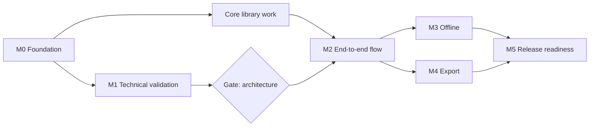

# Roadmap

English | [繁體中文](zh-TW/roadmap.md)

| | |
|---|---|
| Version | 0.1 (draft) |
| Date | 2026-10-19 |
| Status | Planning. No milestone has started. |

This roadmap breaks the development phases in the [Specification §10](specification.md#10-development-phases-and-decision-gates) into milestones with explicit exit criteria. No dates are committed; each milestone starts when its predecessors' exit criteria are met.

## Overview

## M0 — Foundation

Prerequisite for adding any dependency.

| ID | Task | Exit criteria |
|---|---|---|
| M0.1 | Decide the license scope (see [License Feasibility Assessment](license-assessment.md)) | **Done.** Option C adopted ([ADR 0001](adr/0001-dependency-license-scope.md)) |
| M0.2 | Choose the primary language and toolchain consistent with M0.1 | **Done.** [ADR 0003](adr/0003-language-and-toolchain.md) |
| M0.3 | Repository governance: contributing guide, code of conduct, security policy, issue and pull request templates | Documents merged; private vulnerability reporting enabled in repository settings |
| M0.4 | CI license gate: reject unknown, prohibited or unreviewed licenses in lockfiles | **Done.** Verified to reject an unreviewed package and a reviewed MPL-2.0 package ([Development Guide](development.md#license-check)) |
| M0.5 | CI baseline: lint, format and unit test jobs on every pull request | **Done.** Local verification (`verify`, `verify:clean`, Git hooks) and CI on every pull request and push to `main` |
| M0.6 | Localization scaffolding (see [Localization](localization.md)) | `en` and `zh-TW` catalogs load; CI rejects missing keys |
| M0.7 | Public release of the repository | See below |

### M0.7 — Making the repository public

The repository remains private until the project is ready for outside contributors. Before changing its visibility:

1. ~~Review the full Git history for files and content that must not be published.~~ Done.
2. ~~Restore the `pull_request` and `push` triggers in `.github/workflows/ci.yml`~~, and confirm that the first run passes.
3. Require the CI check on `main` in branch protection settings.
4. Enable private vulnerability reporting.
5. Install a DCO check for pull requests.
6. Confirm that README, contributing guide and policies are complete in both languages.

## M1 — Technical Validation (Phase A)

Each spike produces a short report in `docs/spikes/` and a throwaway prototype. Prototypes are not merged into the product code base.

| ID | Spike | Questions to answer | Exit criteria |
|---|---|---|---|
| S1 | Map rendering and data | Which renderer is admissible under M0.1? Which provider permits offline storage and use in exported video? | A license-compliant renderer draws a vector base map from a local file, with Traditional Chinese labels, at 30 fps on the reference devices |
| S2 | Timeline compiler | Is `renderAt(timeUs)` deterministic for a fixed timeline? | Two runs at identical timestamps yield identical camera, captions and media state; Date Line and identical-coordinate cases covered by tests |
| S3 | Web export | Can WebCodecs plus an admissible MP4 muxer produce a 30-second 1080p H.264/AAC file? | File plays in the default players of all five desktop and mobile OS families; audio-video offset ≤ 100 ms |
| S4 | Installed shell | Which shell is admissible under M0.1 and runs on Windows, macOS, Linux, Android and iOS? | The S1 map and S2 timeline run inside the shell on all five platforms |
| S5 | Mobile media bridge | What is the frame throughput between native decoders and the shared compositor? | Sustained 1080p at 30 fps without Base64 transfer, or a documented decision to move rendering to a native pipeline |
| S6 | Web storage | Can OPFS and IndexedDB hold 10 GB of media with crash-safe imports? | Forced termination during import leaves no referenced partial files |

**Gate — architecture decision.** After S1–S6, record which platforms use the shared renderer and which use a native pipeline, and fix the minimum supported OS and browser versions for M2. If a platform cannot meet S3 or S5, revise the support scope before proceeding.

## Core Library Work

The following can start once M0.1 and M0.2 are complete, in parallel with M1, because it has no platform or map dependency:

- Domain model and validation (`domain`).
- Timeline compiler (`timeline`), promoted from the S2 prototype once its design is accepted.
- Project package format specification and reader/writer (`project-package`), including path-traversal and size validation.

## M2 — End-to-End Flow (Phase B)

| Exit criteria |
|---|
| Trip list, itinerary editor, media editor and preview are usable on the Web build and at least one installed platform |
| Autosave with revision checks; reopening a project restores its exact state |
| Versioned project package: back up on one platform and restore on another without loss |
| All UI strings available in `en` and `zh-TW` |

## M3 — Offline (Phase C)

| Exit criteria |
|---|
| Offline package planning, download, pause, resume, verification and differential updates |
| Quota display and insufficient-storage handling |
| Airplane-mode acceptance test passes ([Specification §9](specification.md#9-acceptance-criteria-and-testing)) |
| Network inspection confirms no private data in any request |

## M4 — Export (Phase D)

| Exit criteria |
|---|
| MP4 export on every supported platform, with original audio mixing |
| Cancellation and recovery leave no partial output presented as complete |
| Long-video, low-storage and mixed-format test suites pass |

## M5 — Release Readiness (Phase E)

| Exit criteria |
|---|
| Signed packages for each platform; permission prompts reviewed |
| Accessibility review: keyboard operation, screen-reader labels, sufficient contrast, reduced-motion option for previews |
| License release gate passes ([Dependency License Policy §6](license-policy.md#6-release-gate)) |
| Documentation and store listings complete in `en` and `zh-TW` |
