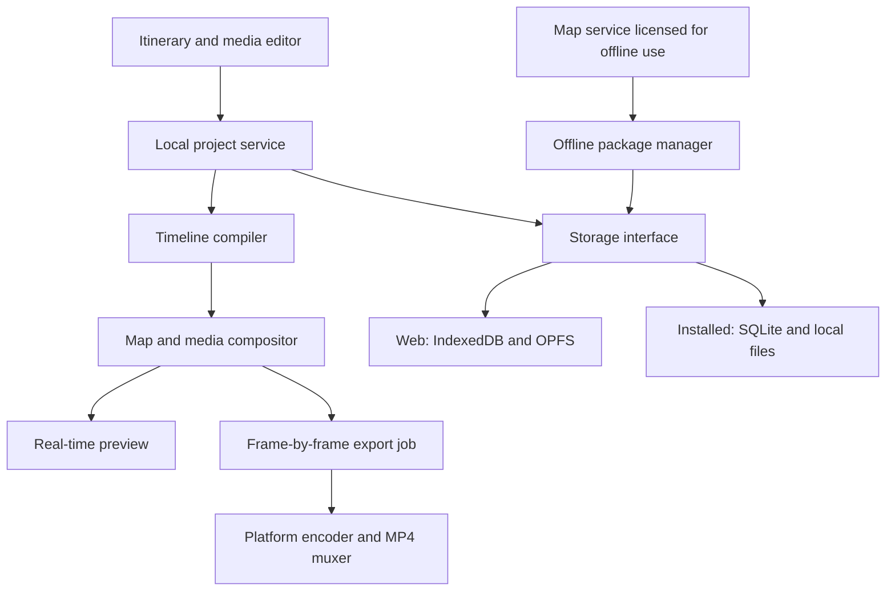

# TripReplay: Product Specification and Technical Design

English | [繁體中文](zh-TW/specification.md)

| | |
|---|---|
| Version | 0.2 (draft) |
| Date | 2026-10-19 |
| Status | Design phase. The technology candidates in this document have not passed the [license audit](license-policy.md). |

> The [Dependency License Policy](license-policy.md) takes precedence over this document. Where a technology choice below conflicts with that policy, the choice is suspended until a compliant alternative is found.

## 1. Overview

TripReplay turns a planned itinerary and the photos and videos captured along the way into an animated travel recap. The recap shows a top-down map, animates the route between stops, zooms into each location, and plays the associated media in order. The result is exported as a video file.

### 1.1 Goals

- Build an itinerary, import photos and videos, and generate an animated recap ordered by stop.
- Export the recap as a video file.
- Run on Web, Windows, macOS, Linux, Android and iOS.
- Keep all private media and processing on the device.
- Allow network access, but support downloading all required resources in advance so that previewing does not depend on mobile data while traveling.

### 1.2 Design Defaults

The following are adjustable defaults for the first release, not additional requirements:

- Single-user, no account required.
- Vector map with schematic connecting lines between stops; a single video track; simple cross-fade transitions.
- Output: MP4, 1080p at 30 fps by default, 720p available; landscape 16:9 and portrait 9:16.

### 1.3 Definition of "Private Data Stays on the Device"

Original photos, videos and audio, EXIF metadata, project contents, thumbnails, proxy media and exported videos are never sent to a remote service.

Place-search queries and map download extents may allow a provider to infer travel destinations. The interface must disclose this clearly and offer manual pin placement and a fully offline mode. If even destinations must not be disclosed to any provider, the application must instead use larger regional map packages and a local place-name index.

## 2. User Flow and Screens

1. **Trip list** — create, open, rename, back up and delete projects; show local storage usage and offline readiness.
2. **Itinerary editor** — stops grouped by date; place search or manual pin placement; reordering; name and description. Supports multi-day trips, multiple countries and crossing the International Date Line.
3. **Media editor** — import from the local file system or the system photo library; assign media to stops; reorder; trim videos; set display duration, rotation and fit mode. GPS and timestamp matching is offered only as a suggestion; when metadata is missing, assignment is manual. The user can correct the time zone.
4. **Recap preview** — map and media preview; play, pause and scrub the timeline; switch aspect ratio. Desktop uses side panels with a bottom timeline; mobile uses the preview with tabbed panels.
5. **Trip preparation** — estimate storage; download required maps, fonts and icons; verify that all media is stored on the device; generate preview proxies; list anything missing.
6. **Video export** — resolution, aspect ratio, title, original-audio toggle; preflight checks, progress, cancellation, actionable error messages, and save or share through the operating system.

### 2.1 Recap Structure

Opening overview → route extends segment by segment → camera moves to the stop and zooms in → place title → photos and videos → zoom out and move to the next stop → full-route overview and closing.

### 2.2 Default Durations

| Element | Duration |
|---|---|
| Opening | 3 s |
| Travel between stops | 2 s |
| Stop title | 1 s |
| Photo | 3 s |
| Video | Trimmed length |
| Closing | 3 s |

Transition overlaps are computed by the timeline compiler; durations are not simply summed. A stop with no media still shows its title and map, never a black frame.

## 3. First Release Scope

**Required:** trip and stop CRUD, reordering, local media import with managed storage, manual media assignment, basic trimming and volume, animated map route, timeline preview, autosave, offline preparation, MP4 export, local project backup and restore, storage and error states.

**Candidates:** GPS and capture-time matching; user-supplied background music. If background music is added, it must be mixed with original audio, and the user is responsible for holding the rights to it.

**Deferred:** turn-by-turn road routing, live GPS tracking, multi-user collaboration, cloud sync, cloud-based AI organization, 3D buildings, satellite imagery, 4K/HDR output, multi-track editing and a template store. Still-image export is out of scope.

## 4. Offline Operation and Privacy

### 4.1 Offline Packages

An offline package is not a browser cache. Each project maintains a resource manifest covering:

- every map extent and zoom level visible along the camera path;
- overview base maps;
- map styles, glyphs (including CJK fonts) and sprites;
- media, thumbnails and proxies.

Source media must be fully copied from the system picker into application-managed storage. Files in a cloud photo library that have not been downloaded must not be reported as offline-ready.

Before downloading, the application shows the estimated size and available space; afterwards it shows the actual size. Downloads support pause, cancel, retry, resumption and integrity verification. Native platforms should offer an explicit "Download on Wi-Fi only" setting. On the Web, where the network type cannot be detected reliably, downloads are started manually and the application makes no claim of accurate network detection.

### 4.2 Package States

`Not prepared` → `Planning` → `Pending download` → `Downloading` → `Verifying` → `Ready`

Additional states: `Cancelled`, `Insufficient storage`, `Failed`, `Update required`.

Changing the route, zoom, aspect ratio or style triggers a differential re-plan and marks the package `Update required`. The existing usable package is kept until the new one is complete.

### 4.3 Offline Mode Rules

- Offline mode issues no remote requests.
- When data is missing, the application states the specific cause and falls back to available lower-resolution map data.
- Final export is blocked if required resources are missing; a blank map is never exported.
- A `Ready` package covers only the planned timeline and configured aspect ratios. Panning outside the package shows a notice.
- Readiness is re-verified at every launch and before every export, because Web storage may be evicted.

The map provider's terms must permit pre-download, local storage and use in exported video, and must state attribution and redistribution conditions for offline packages. Bulk pre-download from the OpenStreetMap standard tile servers is prohibited ([OSM Tile Usage Policy](https://operations.osmfoundation.org/policies/tiles/)).

### 4.4 Privacy Defaults

- No remote analytics, no remote media processing, and no automatic upload of crash attachments.
- Logs never contain full local paths, EXIF data or itinerary contents.
- Remote services are used only for public map resources and user-initiated place search.
- Installed builds must define, and verify per platform, a strategy for excluding sensitive data from automatic OS cloud backups.

## 5. Architecture

The proposed stack uses a shared React and TypeScript code base for the UI, data model and timeline; a Progressive Web App on the Web; and Tauri 2 as the candidate shell for the five installed platforms, with Kotlin and Swift plugins for native mobile capabilities ([Tauri mobile plugins](https://v2.tauri.app/develop/plugins/develop-mobile/)). These are proposals pending technical validation and license audit; not every platform has been verified.

**Shared modules:** `domain`, `timeline`, `renderer`, `offline`, `project-package`, `ui`.
**Platform modules:** `storage`, `media-import`, `media-decode`, `encoder`, `file-export`, `network-policy`.

### 5.1 Key Trade-offs

Web technologies make it easy to share the map and UI, but moving large volumes of video data across the native bridge may become a bottleneck. Between native codec plugins and the shared compositor, use bounded buffers and minimal copying; never pass frames as Base64 over the JavaScript IPC channel. If mobile devices fail validation, keep the domain model and timeline format and move rendering to a native mobile pipeline. This decision must be made before substantial UI work begins.

Candidate map packaging is licensed regional PMTiles or a provider's offline package. PMTiles is only a container format and does not by itself grant offline or redistribution rights. Local random-access reads on the Web and their integration with the map renderer must be implemented and verified; remote HTTP range-request examples do not demonstrate offline support ([Protomaps documentation](https://docs.protomaps.com/)).

## 6. Data Model and Persistence

| Entity | Key fields |
|---|---|
| Trip | id, schemaVersion, title, timezone, startDate, endDate, revision |
| Stop | id, tripId, order, date, name, longitude, latitude, description |
| Asset | id, contentHash, managedUri, type, duration, width, height, rotation, codec, captureTime, timezoneSource, optionalGPS, status |
| Clip | id, stopId, assetId, order, inUs, outUs, photoDurationUs, fit, volume |
| Timeline | version, sourceRevision, segments, cameraKeyframes, audioTracks, totalDurationUs |
| OfflinePack | id, resourceManifest, coverage, zoomRange, styleVersion, attribution, licenseRef, bytes, checksum, status |
| ExportJob | id, tripRevision, settings, state, progress, outputUri, errorCode |

### 6.1 Conventions

- All timeline values are integer microseconds.
- Geographic coordinates are WGS 84, always ordered longitude, latitude.
- Photos, media and stops are related by ID, never by file name or mutable order.
- Deleting a stop prompts the user on how to handle its media. Only assets not referenced by any project may be garbage-collected.

### 6.2 Durability

- Installed builds use database transactions and write to temporary files followed by atomic replacement.
- The Web build stores the manifest in IndexedDB transactions; OPFS files use completion markers so that partial files are never referenced.
- Import streams the copy and computes a content hash, enabling duplicate detection.
- The database and the file system do not share an atomic transaction; on launch, the application scans for incomplete imports and repairs them.

### 6.3 Project Packages

A project package contains a versioned manifest, media and the required license information. Original media is included by default; redistributable offline maps are optional. Packaging is streamed and never loads the whole package into memory. Restore validates hashes, format version, path traversal, file sizes and available storage before importing. In the first release, moving projects between devices is a manual operation; there is no automatic sync.

The Web build may request persistent storage and display quota, but cannot guarantee that data will not be evicted; project packages are the supported backup mechanism ([MDN: Origin private file system](https://developer.mozilla.org/en-US/docs/Web/API/File_System_API/Origin_private_file_system)).

## 7. Preview and Video Pipeline

The timeline compiler converts the itinerary into explicit segments, camera keyframes and media intervals. `renderAt(timeUs, settings)` determines the camera, route progress, captions, media and opacity for any point in time. Preview and export share this single definition; the map library's real-time `flyTo` animation is never the sole source of truth for export. Routes crossing the International Date Line take the shortest reasonable path, and intercontinental legs adjust the overview scale.

Preview may use lower-resolution proxies and preload the next stop. Export decodes from the original media and renders each frame at 30 fps timestamps. Each frame waits until all required tiles, fonts and media are ready before it is encoded. Audio is trimmed, resampled and mixed independently according to the timeline, then muxed into MP4. The full video is never held in memory; decode, render and encode stages are connected by bounded queues with back-pressure.

### 7.1 Input and Output Formats

The baseline input set is JPEG, PNG and H.264/AAC MP4. HEIC, HEVC, MOV, HDR and variable-frame-rate sources are mandatory test inputs; depending on platform capability they are converted locally or reported as unsupported. Output targets SDR and must handle rotation, color and audio-video synchronization correctly. Codecs are never inferred from file extensions.

| Platform | Encoder design | Support commitment |
|---|---|---|
| Web | WebCodecs with an MP4 muxer; audio and video encoder configurations are probed before export | Local MP4 export on supported browsers and devices; unsupported environments are reported clearly, and the project can be backed up and exported from an installed build |
| Windows / macOS / Linux | Local encoding service using system encoders or another license-compliant encoder | H.264, AAC, licensing, packaging and hardware differences verified before release |
| Android | Kotlin plugin bridging the native codec and muxer pipeline | Verified on physical devices for long videos, thermals, memory and background interruption |
| iOS | Swift plugin bridging the native codec and muxer pipeline | Verified on physical devices for photo library assets, color, background interruption and output |

WebCodecs support must be checked on real devices; the ability to play a format does not imply the ability to encode it ([MDN: Codec selection](https://developer.mozilla.org/en-US/docs/Web/API/WebCodecs_API/Codec_selection)).

"Cross-platform" means the core product is usable on all six platform families; it does not mean every browser supports identical output. Guaranteeing MP4 export in every browser would require separately validating a local WASM encoder for performance, storage and licensing, which is not currently committed.

On mobile, the first release requires export to remain in the foreground. If the application is backgrounded or terminated by the system, the export is cleanly aborted and can be restarted; unlimited background execution is not promised. Edits are saved continuously, and until export completes only a temporary file exists, so a corrupted file is never presented as a finished result.

## 8. Internal Interfaces and Job States

| Service | Operations |
|---|---|
| `ProjectRepository` | `load`, `save(expectedRevision)`, `list`, `delete`, `recover` |
| `AssetService` | `import`, `inspect`, `createProxy`, `resolve`, `verify`, `removeUnreferenced` |
| `OfflineService` | `plan(tripRevision, viewport, style)`, `download`, `pause`, `resume`, `verify`, `remove` |
| `TimelineCompiler` | `compile(project, settings)` → immutable timeline |
| `RenderEngine` | `prepare(timeline)`, `renderAt(timeUs)`, `release` |
| `ExportService` | `capabilities`, `preflight`, `start`, `cancel`, `status` |

- Every long-running operation returns a `jobId`. Progress events carry `phase`, `completed`, `total` and `errorCode`; time estimates are reported separately from progress.
- Export phases: preparing → decoding and rendering → encoding and muxing → verifying → completed. On failure or cancellation, all reconstructible temporary files are removed.
- Download retries are deduplicated by resource hash and version.
- Export pins the project revision so that concurrent edits do not alter the output.

The first release requires no backend for private data. If the project operates its own map service, that service only distributes public map packages and version metadata; it never receives user media, project files or encoding jobs.

## 9. Acceptance Criteria and Testing

The targets below are proposed and have not yet been measured. Reference devices — exact model, OS, browser and memory — will be recorded during technical validation before final thresholds are set.

| Scenario | Pass criteria |
|---|---|
| End-to-end flow | A trip with 10 stops, 50 photos and 10 short clips can be created, edited, saved, reopened and exported |
| Airplane mode | After preparation, relaunch the application; full preview and export complete with no remote requests |
| Network privacy | All requests are inspected; none contain private media, EXIF data, project contents or local paths |
| Offline invalidation | Changes to stops, style or aspect ratio prompt for additional downloads; missing files are never reported as ready |
| Video correctness | Order, trimming, rotation, captions and duration are correct; audio-video offset targets ≤ 100 ms |
| Reproducible frames | Composition and media at a given timestamp are identical across runs; pixel-exact output across GPUs is not required |
| Interactive performance | Preview targets 30 fps and may reduce quality under load; dropped-frame rate and peak memory are recorded |
| Large media sets | 10 GB of total media including 4K sources is processed by streaming without exhausting memory |
| Crash recovery | After force-quitting during import, download or export, the project still opens and no false success is reported |
| Cross-platform projects | Project packages exchanged across all six platforms preserve order, trimming, coordinates, timing and media |
| Abnormal input | Missing GPS, wrong time zone, stops without media, silent clips, corrupted files and full disks all produce explicit results |
| Map edge cases | Date Line crossings, identical coordinates, multi-country and long-distance routes have no incorrect wrapping or unreasonable zoom |

Web testing covers the supported scope of Chrome, Edge, Firefox and Safari; installed builds are tested individually on Windows, macOS, Linux, Android and iOS. Minimum OS and browser versions are fixed only after codec testing; full support is not claimed in advance.

## 10. Development Phases and Decision Gates

| Phase | Scope |
|---|---|
| A | Using one short timeline, achieve map rendering, local file access, video decoding and a 30-second MP4 export on all six platform families; validate iOS and Android bridge performance. If this gate fails, revise the native pipeline or the supported scope first. |
| B | Complete the end-to-end flow for itinerary, media, local persistence and preview; establish the versioned project package. |
| C | Offline packages, resumable downloads, quota management, missing-resource checks and true disconnected acceptance testing. |
| D | Export on every platform, audio, cancellation and recovery; test long videos, low storage and varied input formats. |
| E | Platform packaging, code signing, permissions, accessibility and release preparation. iOS builds and tests require macOS, Xcode and physical devices; success on a Windows development environment is not a substitute ([Tauri prerequisites](https://v2.tauri.app/start/prerequisites/)). |

No fixed schedule is estimated yet; staffing, test devices and map budget are still undetermined. The largest risks are the video pipeline and map licensing, not the number of screens.

## 11. Open Questions

The following do not block this version of the design:

- Map data budget and provider: offline use, use in videos, attribution, redistribution and update policy.
- Whether "private" also prohibits disclosing stops and download extents to map providers.
- Minimum device and browser support, typical media volume per trip, and maximum video length.
- Whether background music and GPS-based media matching are required in the first release.
- Release order (mobile first or desktop first). All six platforms remain in scope but may ship in stages.

To be evaluated as the project grows: cross-project deduplication, proxy cache cleanup, larger offline region indexes, 4K/HDR, and native rendering performance. Any future sync or cloud feature requires a fresh privacy review and must not be enabled by default.
