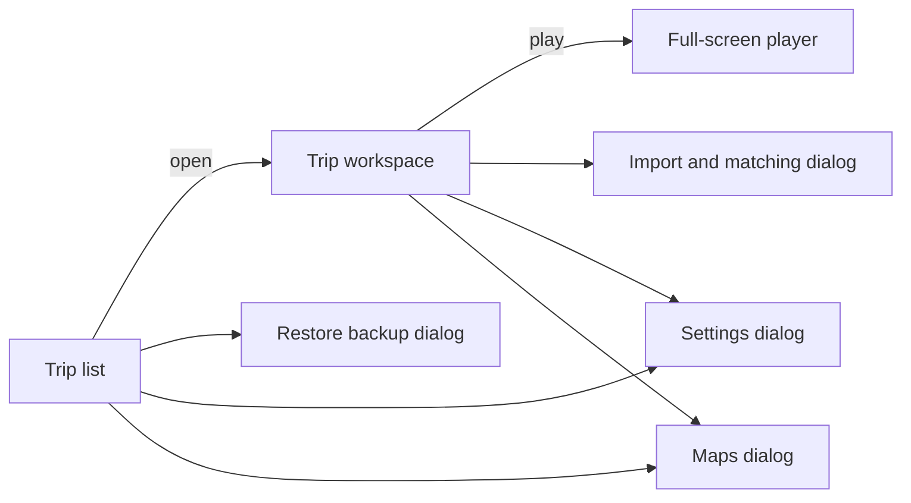

# Screen Design

English | [繁體中文](zh-TW/ui-design.md)

| | |
|---|---|
| Version | 0.2 (draft) |
| Date | 2026-10-24 |
| Status | Design. Describes the screens of version 1.0 ([1.0 Definition](release-1.0.md)). |

## 1. Structure

Version 1.0 has three screens and a small number of dialogs:



Editing and preview share **one workspace**, so every change is visible immediately without switching screens.

## 2. Trip List

- A grid of trip cards. Each card shows a route thumbnail rendered from the trip's closing overview, the trip name, dates, number of stops and storage used.
- A "⋯" menu on each card: rename, duplicate, back up, delete.
- A "New trip" button in the heading and as the last card.
- With no trips, a single call to action: "Create your first trip".
- The header offers "Trips", "Maps" and "Settings"; the trip list offers "Restore backup", and each card "Back up". A backup is one project package file ([Project Package Format](project-package.md)); where the browser can, it is written straight to the chosen file. A backup whose trip is already on the device can be restored as a copy.

### 2.1 Maps dialog

Maps are downloaded once and then used on the device ([ADR 0006](adr/0006-local-only-operation.md)).

- A list of regions (for example countries), each with its size and state: not downloaded, downloading with progress, ready with the space used, or update available.
- One button per region: "Download", "Pause" or "Resume", "Update", "Delete". The size and the free space are shown before a download starts.
- "Open map files" adds a map already on the device: the PMTiles files of the Overture Maps themes base, transportation and divisions, opened together, and places for points of interest. The files are copied into storage; the region is listed by the name of its base file and can only be deleted, not updated.
- On first use, and whenever a stop lies outside the downloaded regions, the application opens this dialog with the matching region preselected.
- A note states that the download source can see which regions are downloaded, and nothing else.

## 3. Trip Workspace

### 3.1 Desktop layout

```
┌──────────────────────────────────────────────────────────────┐
│ ← Trip name                  [16:9 | 9:16]  [▶ Play]  [⚙]    │
├──────────────────┬───────────────────────────────────────────┤
│ Itinerary│Media│  │                                           │
│ Music│Themes      │              Preview                      │
│                  │                                           │
│ Day 1 · 4/1      │                                           │
│  ① Kyoto Sta. ⠿  │                                           │
│  ② Fushimi    ⠿  │                          map attribution  │
├──────────────────┴───────────────────────────────────────────┤
│ ▶  00:42 / 03:10                                             │
│ Opening│→│Title│Photo│Photo│→│Title│Video│ … │Closing         │
│ ♪ Background music ════════════════════════════              │
└──────────────────────────────────────────────────────────────┘
```

- **Side panel** (320 px) with four tabs, described in §3.3.
- **Preview** fills the remaining area at the selected aspect ratio.
- **Timeline** spans the full width at the bottom.

### 3.2 Mobile layout

Below 820 px wide, the same parts stack vertically: preview (about half the screen height, more for 9:16), timeline, then the tabbed panel. Nothing is hidden; only the arrangement changes.

### 3.3 Side panel tabs

| Tab | Content |
|---|---|
| Itinerary | Stops grouped by day, each with a number, name and media count. Drag the handle to reorder, including across days. Selecting a stop moves the preview to that stop. Stops are added by searching place names in the downloaded maps, by "Drop a pin", or by pasting coordinates or a map link (for example from Google Maps). |
| Media | "Import media" button; thumbnails of the selected stop's media in order. Selecting a photo shows its duration; selecting a video shows trim handles and volume. |
| Journal | The trip as a diary, day by day: each stop with its journal entry, and each photo or video with a short note (at most 500 characters) that becomes its caption. An entry is saved as one undoable change when the field loses focus, or with Ctrl+Enter or Cmd+Enter. Selecting a stop's name moves the preview to that stop. |
| Music | Imported tracks; fade-in, fade-out, and "Lower music during clips with sound"; volume. |
| Themes | Theme cards with a small preview; selecting one applies it immediately. Choosing the portrait theme also switches the preview to 9:16. |

### 3.4 Timeline

- One row of segments in order: opening, travel (→), stop title, photos, videos, closing. Width is proportional to duration; segment colors distinguish the types.
- A separate row shows the background music, with darker regions where it is lowered under clips with sound.
- A scale above the segments marks the time, every 1, 2, 5, 10, 15 or 30 seconds or more, with at most eight marks in view.
- **Zoom:** − and + buttons above the timeline halve or double its width, from the whole recap up to the zoom at which 5 seconds fill the width; they appear only for a recap long enough to zoom. A zoomed timeline scrolls sideways by swiping, and an overview bar under it shows the whole recap with the part in view as a window that can be dragged, or moved by clicking beside it. Zooming keeps the playhead where it was in view; during playback the timeline scrolls to keep the playhead in view.
- Clicking or dragging on the timeline moves the playhead; space toggles playback.
- **Durations are edited by dragging, or as numbers:**

| Segment | Drag behavior |
|---|---|
| Photo | Drag the right edge to change its duration, snapping to 0.5 s, from 1 s to 15 s |
| Video | Drag either edge to trim the start or end, within the clip's length |
| Music | Drag the clip to move it; drag either end to trim |
| Opening, travel, title, closing | Not dragged; edited as numbers for the whole trip, from 0.5 s to 15 s in steps of 0.5 s |

- Clicking a segment also selects it: a panel under the timeline names it with its start and end, and offers its values in seconds — a photo's duration, a video's in and out points, a music track's start, or the length of the phase for the whole trip. A value is applied when the field loses focus or with Enter. **Close** hides the panel.
- Each change is a single command and can be undone.
- The selected stop's segments are highlighted; selecting a segment selects its stop and media in the side panel.

## 4. Import and Matching Dialog

1. The user selects files; a progress bar shows metadata being read.
2. **Suggested matches** list each item with its capture time and the suggested stop in a drop-down. Each suggestion must be accepted individually or with "Accept all"; nothing is applied silently.
3. **Cannot determine** lists items without GPS data or capture time, each with a stop selector for manual assignment.
4. The trip's **time zone** is shown with a "Change" action, so that a wrong camera clock can be corrected for all items at once.
5. "Finish import" adds the accepted and manually assigned items; "Cancel" adds nothing.

## 5. Full-Screen Player

- Only the recap is shown, at the selected aspect ratio, letterboxed on black.
- Controls (play or pause, progress, time, exit) fade out after 2.5 seconds without pointer movement and return on movement.
- Escape exits. The map attribution remains visible throughout.

## 6. The Recap

| Phase | Default duration | What the viewer sees |
|---|---|---|
| Opening | 3 s | Overview of the whole trip with all stops marked; trip name and dates fade in |
| Travel | 2 s | The camera flies to the next stop, zooming out for long distances; the route draws itself along the way |
| Stop title | 1 s, longer with a journal entry | The camera settles on the stop; its name and day appear, and the first 80 characters of its journal entry in up to three centered lines in the theme's journal serif, on a soft dark glow. A fine rule parts around the stop's marker (or shows a diamond in the route color) between the date and the entry, and the lines rise into place one after another, all within the first half of the title. The title lasts at least 1.5 s plus 0.12 s per character of the entry, up to 10 s |
| Photo | 3 s each | A framed photo over the map with a slow push-in, and its note in up to two centered lines of the journal serif over the bottom of the picture, on a shade that deepens downwards, appearing shortly after the photo; the stop name stays in a corner |
| Video | Trimmed length | A framed video with its original sound, its note over the picture like a photo's, and a progress bar |
| Closing | 3 s | The camera returns to the overview with the complete route; trip summary fades in |

The opening, travel, stop title and closing lengths come from the theme unless the trip sets its own (§3.4).

With "Reduce motion" enabled, camera moves and push-ins are replaced by cross-fades, and journal lines and notes fade in without rising. The **Reduce motion** button under the preview starts as the system setting and keeps the user's choice in the browser.

## 7. Themes

| Theme | Look | Intended use |
|---|---|---|
| Classic | Light map, dark red route, white titles with shadow | General use, 16:9 |
| Night | Dark map, glowing yellow route | Evening viewing and projection |
| Portrait | Large title at the top, media in the lower half | 9:16 sharing on phones |

The application interface itself follows the system light or dark setting, independently of the recap theme.

## 8. Accessibility

- Every action is available by keyboard: tabs, stop list, timeline (arrow keys move the playhead and resize the focused segment), dialogs.
- Drag-and-drop operations have keyboard equivalents: move up or down for stops, and duration fields for segments.
- Screen-reader labels for every control; the preview announces the current stop.
- WCAG 2.2 AA contrast in both interface color schemes.
