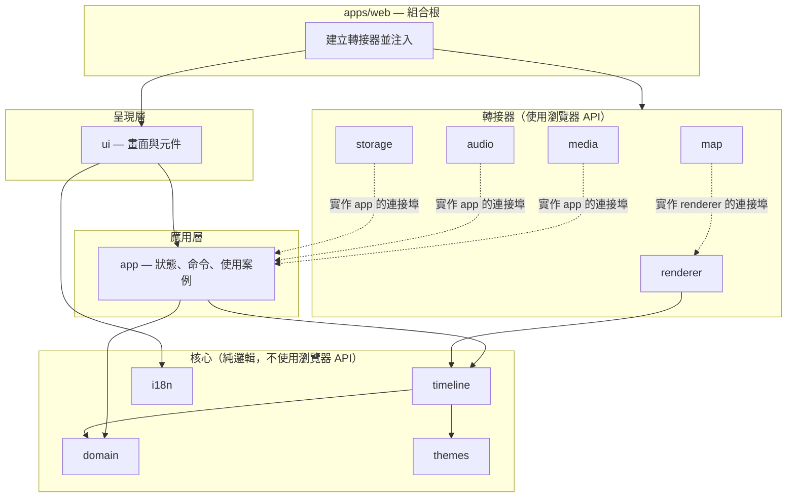
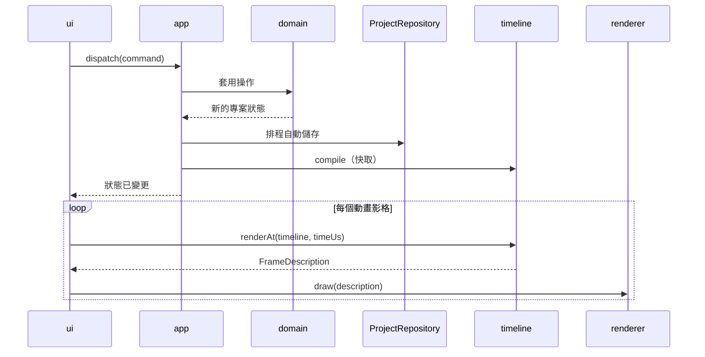

# 應用程式架構

[English](../architecture.md) | 繁體中文

> 本文件為英文版之翻譯；如有歧異，以英文版為準。

| | |
|---|---|
| 版本 | 0.1（草案） |
| 日期 | 2026-10-20 |
| 狀態 | 設計。適用於所有產品程式碼；見 [ADR 0005](adr/0005-modular-architecture.md)。 |

## 1. 目標

- **可替換的元件。** 任何模組——地圖渲染器、儲存、UI 框架或主題——皆可重寫或替換，而不影響無關的程式碼。
- **可測試的核心。** 所有決定畫面上*呈現什麼*的邏輯，皆為不需瀏覽器即可執行的純 TypeScript。
- **為後續版本做好準備。** MP4 匯出、離線包及安裝版（[1.0 定義 §4.3](release-1.0.md#43-10-之後)）以新增模組的方式加入，而非重新設計既有模組。

## 2. 分層



| 層級 | 規則 |
|---|---|
| 核心 | 純函式與資料。不使用 DOM、網路、儲存或計時器。以單元測試完整涵蓋。 |
| 應用層 | 保存狀態並協調使用案例。僅透過自行定義的**連接埠**（TypeScript 介面）與外界溝通。不使用 DOM。 |
| 轉接器 | 以瀏覽器 API（Canvas、WebGL、IndexedDB、OPFS、Web Audio、File System Access）實作連接埠。每種技術一個轉接器。 |
| 呈現層 | 呈現狀態並發送命令。絕不直接呼叫儲存、媒體或地圖程式碼。 |
| 外殼 | 唯一知道所有具體實作的地方。建立轉接器、注入應用層、掛載 UI，並註冊 Service Worker。 |

## 3. 套件

| 套件 | 職責 | 可相依於 |
|---|---|---|
| `domain` | 實體（Trip、Stop、Asset、Clip、MusicTrack）、不變條件，以及排序、指派、裁剪等純操作 | — |
| `themes` | 以資料定義主題：顏色、字型，以及 16:9 與 9:16 的版面規則 | — |
| `i18n` | 語系判定與訊息目錄（已存在） | — |
| `timeline` | `compile(project, settings)` → 不可變的 Timeline；`renderAt(timeline, timeUs)` → **FrameDescription** | `domain`、`themes` |
| `app` | 狀態、可復原與重做的命令、自動儲存排程、使用案例（匯入、配對、備份、還原）；定義下列連接埠 | `domain`、`timeline` |
| `renderer` | 將 FrameDescription 繪製到畫布；定義 `MapLayer` 與 `MediaSource` 連接埠 | `timeline` |
| `map` | 以選定的地圖引擎實作 `MapLayer`；圖磚來源；離線包介面（1.0 僅提供線上實作） | `renderer` |
| `media` | 檔案匯入、中繼資料（拍攝時間、GPS）、縮圖與代理檔、景點配對建議；實作 `MediaPort` | `domain`、`app` |
| `audio` | 以 Web Audio 進行預覽混音：音樂、淡入淡出、自動降低音量；實作 `AudioPort` | `timeline`、`app` |
| `storage` | IndexedDB 與 OPFS 持久化、專案包備份與還原；實作 `ProjectRepository` 與 `AssetStore` | `domain`、`app` |
| `ui` | 畫面與元件（旅行列表、工作區、對話框、播放器） | `app`、`i18n`、`themes` |
| `apps/web` | 組合根與 PWA 外殼 | 全部 |

後續版本在不修改上述套件的前提下新增套件：`export`（將 `renderer` 的影格編碼）、`map` 內的離線實作，以及 `apps/` 下的各平台外殼。

## 4. 關鍵契約

### 4.1 FrameDescription

`renderAt` 不負責繪製，而是回傳描述該影格的純物件：

```ts
interface FrameDescription {
  readonly timeUs: number;
  readonly segmentIndex: number;                          // 此時間所在的片段
  readonly segmentKind: Segment["kind"];
  readonly camera: { readonly center: LonLat; readonly zoom: number; readonly bearing: number };
  readonly route: { readonly progress: number };          // 已抵達的景點數，移動中為小數
  readonly markers: readonly MarkerState[];               // 已造訪、目前、未抵達
  readonly overlays: readonly Overlay[];                  // 標題、字幕、媒體卡片、來源標示
  readonly audio: readonly AudioState[];                  // 片段聲音與音樂，含增益
  readonly fade: number;                                  // 0–1，供減少動態效果使用
}
```

完整定義及其設計決策見 [`packages/timeline`](../../packages/timeline/src/frame.ts) 與 [S2 報告](spikes/s2-timeline-compiler.md)。

由於影格是資料，同一份描述可同時驅動預覽、全螢幕播放器，以及日後的匯出；繪製技術也能在不影響時間軸的情況下更換。確定性以比對描述而非像素的方式測試。

### 4.2 連接埠

| 連接埠 | 定義於 | 1.0 實作 | 後續 |
|---|---|---|---|
| `ProjectRepository` — 載入、含修訂版本檢查的儲存、列出、刪除 | `app` | `storage`（IndexedDB） | 安裝版使用 SQLite |
| `AssetStore` — 存放、讀取、移除媒體檔案 | `app` | `storage`（OPFS） | 原生檔案系統 |
| `MediaPort` — 讀取中繼資料、產生縮圖與代理檔 | `app` | `media`（瀏覽器解碼器） | 原生解碼器 |
| `AudioPort` — 播放、暫停、跳轉混音後的預覽 | `app` | `audio`（Web Audio） | — |
| `MapLayer` — 依鏡頭繪製底圖 | `renderer` | `map`（線上圖磚） | 離線包 |
| `MediaSource` — 提供片段在指定時間的解碼影格 | `renderer` | `media` | 匯出用解碼器 |
| `Clock` — 目前時間與影格排程 | `app` | `requestAnimationFrame` | 匯出用固定步進時鐘 |
| `Scheduler` — 延遲後執行回呼，供自動儲存使用 | `app` | `setTimeout` | — |

測試時，所有連接埠皆以記憶體內的替身取代。

### 4.3 資料流



狀態單向流動。命令是變更狀態的唯一途徑，因此自然具備復原與重做功能，且每個使用者操作皆可在沒有 UI 的情況下測試。

## 5. 規則

1. **相依只能向內。** 核心不相依任何套件；轉接器與呈現層相依於核心與應用層，反之則不行。不允許循環相依。
2. **僅透過套件進入點使用公開 API。** 不得匯入其他套件的內部檔案。
3. **每個檔案一個職責。** 原則上單一檔案不超過 300 行；過長即表示應拆分。
4. **瀏覽器 API 僅用於轉接器與外殼。** 核心與應用層程式碼必須能在 Node.js 測試中執行。
5. **不使用全域狀態。** 相依由外殼傳入，而非以單例匯入。
6. **新技術一律置於連接埠之後。** 新增涉及瀏覽器、網路或儲存的第三方函式庫時，須透過連接埠，使其可被替換。

規則 1 與 2 由 `pnpm run deps:check`（包含於 `pnpm run verify`）依 [`tools/deps-check/boundaries.json`](../../tools/deps-check/boundaries.json) 中允許的相依關係執行。規則 4 由型別檢查執行：共用的 TypeScript 設定不含 DOM 型別，因此核心與應用層程式碼無法引用瀏覽器 API。轉接器套件列於 `tsconfig.browser.json`，僅對這些套件加入 DOM 型別。

## 6. 各層測試

| 層級 | 方式 |
|---|---|
| 核心 | 單元測試；時間軸的性質測試（時間單調遞增、確定性、換日線處理） |
| 應用層 | 以連接埠替身進行單元測試；命令與復原的操作序列 |
| 轉接器 | 於真實瀏覽器中進行整合測試 |
| 呈現層 | 元件測試；無障礙檢查 |
| 端對端 | 於真實瀏覽器中執行 [1.0 定義 §2](release-1.0.md#2-目標使用者與核心情境) 的核心情境 |

## 7. 技術選擇

| 面向 | 選擇 | 說明 |
|---|---|---|
| UI 框架 | React | 僅限於 `ui` 與 `apps/web` |
| 狀態管理 | `app` 中基於 `useSyncExternalStore` 的小型狀態容器 | 不相依狀態管理函式庫 |
| 樣式 | CSS Modules | 打包工具內建；設計權杖以 CSS 自訂屬性共用 |
| 地圖引擎 | 於技術驗證 S1 決定 | 僅於 `map` 內使用 |
| 打包與開發伺服器 | Vite | 開發工具 |

所有執行期函式庫仍須遵守[相依套件授權政策](license-policy.md)。
