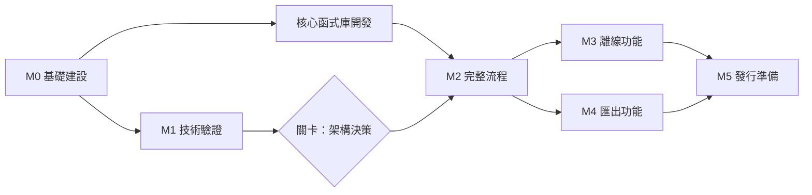

# 開發路線圖

[English](../roadmap.md) | 繁體中文

> 本文件為英文版之翻譯；如有歧異，以英文版為準。

| | |
|---|---|
| 版本 | 0.1（草案） |
| 日期 | 2026-10-19 |
| 狀態 | 規劃中，尚無里程碑啟動。 |

本路線圖將[產品規格 §10](specification.md#10-開發階段與決策關卡) 的開發階段拆分為具備明確完成條件的里程碑。目前不承諾任何日期；各里程碑在前置里程碑的完成條件達成後啟動。

## 總覽

## M0 — 基礎建設

加入任何相依套件前須先完成。

| 編號 | 工作項目 | 完成條件 |
|---|---|---|
| M0.1 | 決定授權範圍（見[授權可行性評估](license-assessment.md)） | **已完成。** 採行選項 C（[ADR 0001](adr/0001-dependency-license-scope.md)） |
| M0.2 | 依 M0.1 選定主要程式語言與工具鏈 | 記錄為架構決策 |
| M0.3 | 版本庫治理：貢獻指南、行為準則、安全政策、Issue 與 Pull Request 範本 | 文件已合併；已於版本庫設定中啟用私下回報弱點功能 |
| M0.4 | CI 授權檢查：於 lockfile 中拒絕未知、禁止或未經審查的授權 | 在加入禁止套件的測試分支上檢查失敗 |
| M0.5 | CI 基準：每個 Pull Request 皆執行 lint、格式檢查及單元測試 | `main` 已啟用必要檢查 |
| M0.6 | 在地化基礎架構（見[在地化](localization.md)） | `en` 與 `zh-TW` 訊息目錄可載入；CI 拒絕缺漏的鍵值 |

## M1 — 技術驗證（階段 A）

每項技術驗證皆產出一份簡短報告（置於 `docs/spikes/`）及一個用後即棄的原型。原型不合併至產品程式碼。

| 編號 | 技術驗證 | 待解答問題 | 完成條件 |
|---|---|---|---|
| S1 | 地圖渲染與資料 | 在 M0.1 下可採用哪個渲染器？哪家供應商允許離線儲存及用於匯出影片？ | 符合授權的渲染器可從本機檔案繪製向量底圖並顯示繁體中文標籤，於參考裝置上達 30 fps |
| S2 | 時間軸編譯器 | 對固定時間軸而言，`renderAt(timeUs)` 是否具確定性？ | 相同時間點的兩次執行產生相同的鏡頭、字幕及媒體狀態；測試涵蓋換日線及相同座標情境 |
| S3 | Web 匯出 | WebCodecs 搭配可採用的 MP4 封裝器，能否產出 30 秒 1080p H.264／AAC 檔案？ | 檔案可在五類桌面與行動作業系統的預設播放器播放；影音偏差 ≤ 100 ms |
| S4 | 安裝版外殼 | 在 M0.1 下可採用哪個外殼，並能在 Windows、macOS、Linux、Android 及 iOS 上執行？ | S1 地圖與 S2 時間軸可在五個平台的外殼內執行 |
| S5 | 行動裝置媒體橋接 | 原生解碼器與共用合成器之間的影格傳輸量為何？ | 不使用 Base64 傳輸即可持續達到 1080p、30 fps，或記錄改採原生渲染管線的決策 |
| S6 | Web 儲存 | OPFS 與 IndexedDB 能否保存 10 GB 媒體並確保匯入時當機安全？ | 匯入期間強制終止後，不會留下被引用的未完成檔案 |

**關卡 — 架構決策。** 完成 S1–S6 後，記錄各平台採用共用渲染器或原生管線，並確定 M2 的最低支援作業系統與瀏覽器版本。若某平台無法通過 S3 或 S5，須先修訂支援範圍再繼續。

## 核心函式庫開發

下列工作不相依於平台或地圖，因此在 M0.1 與 M0.2 完成後即可與 M1 並行展開：

- 領域模型與驗證（`domain`）。
- 時間軸編譯器（`timeline`），待 S2 原型的設計獲接受後正式開發。
- 專案包格式規格及讀寫器（`project-package`），含路徑穿越與檔案大小驗證。

## M2 — 完整流程（階段 B）

| 完成條件 |
|---|
| 旅行列表、行程編輯、媒體編輯及預覽，可在 Web 版及至少一個安裝版平台上使用 |
| 具修訂版本檢查的自動儲存；重新開啟專案可還原至完全相同的狀態 |
| 版本化專案包：可在一個平台備份、在另一平台還原且不遺失資料 |
| 所有 UI 字串皆提供 `en` 與 `zh-TW` |

## M3 — 離線功能（階段 C）

| 完成條件 |
|---|
| 離線包的規劃、下載、暫停、續傳、驗證及差異更新 |
| 配額顯示與空間不足處理 |
| 通過飛航模式驗收測試（[產品規格 §9](specification.md#9-驗收標準與測試)） |
| 網路檢查確認所有請求皆不含私人資料 |

## M4 — 匯出功能（階段 D）

| 完成條件 |
|---|
| 所有支援平台皆可匯出 MP4，並可混入原始音訊 |
| 取消與復原後，不會將未完成的輸出呈現為完成成品 |
| 通過長片、低儲存空間及混合格式測試 |

## M5 — 發行準備（階段 E）

| 完成條件 |
|---|
| 各平台皆有已簽署的安裝套件；權限提示已審閱 |
| 無障礙審查：鍵盤操作、螢幕閱讀器標籤、足夠的對比度，以及預覽的減少動態效果選項 |
| 通過授權發行門檻（[相依套件授權政策 §4](license-policy.md#4-發行門檻)） |
| 文件與商店上架資訊皆提供 `en` 與 `zh-TW` |
