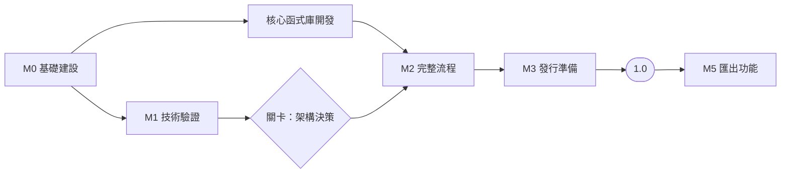

# 開發路線圖

[English](../roadmap.md) | 繁體中文

> 本文件為英文版之翻譯；如有歧異，以英文版為準。

| | |
|---|---|
| 版本 | 0.1（草案） |
| 日期 | 2026-10-19 |
| 狀態 | 規劃中，尚無里程碑啟動。 |

本路線圖將[產品規格 §10](specification.md#10-開發階段與決策關卡) 的開發階段拆分為具備明確完成條件的里程碑，最終達成 [1.0 定義](release-1.0.md)所述的發行。目前不承諾任何日期；各里程碑在前置里程碑的完成條件達成後啟動。

## 總覽

里程碑 M0 至 M3 達成 1.0，交付完全在裝置上執行的畫面體驗。M5 構成下一個版本（[1.0 定義 §4.3](release-1.0.md#43-10-之後)）。原 M4（離線功能）已併入 M2（[ADR 0006](adr/0006-local-only-operation.md)）。

## M0 — 基礎建設

加入任何相依套件前須先完成。

| 編號 | 工作項目 | 完成條件 |
|---|---|---|
| M0.1 | 決定授權範圍（見[授權可行性評估](license-assessment.md)） | **已完成。** 採行選項 C（[ADR 0001](adr/0001-dependency-license-scope.md)） |
| M0.2 | 依 M0.1 選定主要程式語言與工具鏈 | **已完成。** [ADR 0003](adr/0003-language-and-toolchain.md) |
| M0.3 | 版本庫治理：貢獻指南、行為準則、安全政策、Issue 與 Pull Request 範本 | 文件已合併；已於版本庫設定中啟用私下回報弱點功能 |
| M0.4 | CI 授權檢查：於 lockfile 中拒絕未知、禁止或未經審查的授權 | **已完成。** 已驗證可拒絕未經審查的套件，以及已列入清單的 MPL-2.0 套件（[開發指南](development.md#授權檢查)） |
| M0.5 | CI 基準：每個 Pull Request 皆執行 lint、格式檢查及單元測試 | **已完成。** 本機驗證（`verify`、`verify:clean`、Git hooks），以及每個 Pull Request 與推送至 `main` 時執行的 CI |
| M0.6 | 在地化基礎架構（見[在地化](localization.md)） | **已完成。** `packages/i18n` 可載入 `en` 與 `zh-TW` 訊息目錄；`i18n:check` 拒絕缺漏的鍵值與不一致的參數 |
| M0.7 | 公開版本庫 | 見下方 |

### M0.7 — 公開版本庫

版本庫將維持私有，直到專案準備好接受外部貢獻者。變更可見性之前：

1. ~~審閱完整的 Git 歷史，確認無不得公開的檔案或內容。~~ 已完成。
2. ~~於 `.github/workflows/ci.yml` 恢復 `pull_request` 與 `push` 觸發條件，並確認首次執行通過。~~ 已完成。
3. 於分支保護設定中，將 CI 檢查設為 `main` 的必要檢查。
4. 啟用私下回報弱點功能。
5. 確認 README、貢獻指南及各項政策的兩種語言版本皆已完備。

## M1 — 技術驗證（階段 A）

每項技術驗證皆產出一份簡短報告（置於 `docs/spikes/`）及一個用後即棄的原型。原型不合併至產品程式碼；惟技術驗證結論認定原型已符合產品標準者除外，例如 S2。

| 編號 | 技術驗證 | 待解答問題 | 完成條件 |
|---|---|---|---|
| S1 | 地圖渲染與資料 | 在 M0.1 下可採用哪個渲染器？哪些地圖檔可依區域下載，且能否從裝置上依範圍讀取？如何在裝置上搜尋地名？ | 符合授權的渲染器可從裝置上的檔案繪製 OpenStreetMap 向量底圖並顯示繁體中文標籤，於參考裝置上達 30 fps；完成已下載地圖的地名搜尋量測。**已完成。** 渲染器、圖磚格式及標籤（[報告](spikes/s1-map-rendering.md)）；已驗證以 Overture Maps 作為下載來源（CORS、範圍讀取、區域大小、名稱）；已量測裝置上的地點搜尋；三台裝置於 1080p 皆達 30 fps |
| S2 | 時間軸編譯器 | 對固定時間軸而言，`renderAt(timeUs)` 是否具確定性？ | **已完成。** 相同時間點的兩次執行產生相同的鏡頭、字幕及媒體狀態；測試涵蓋換日線及相同座標情境（[報告](spikes/s2-timeline-compiler.md)） |
| S6 | Web 儲存 | OPFS 與 IndexedDB 能否保存 10 GB 媒體並確保匯入時當機安全？ | **已完成。** 在 Chromium 中，匯入期間強制終止後不會留下被引用的未完成檔案；匯入所需功能在 Chromium、Android System WebView 及 WebKit 中皆可使用；配額可能低至 1 GB；Firefox 於 M2 進行（[報告](spikes/s6-web-storage.md)） |

技術驗證 S3（Web 匯出）移至 M5。技術驗證 S4（安裝版外殼）與 S5（行動裝置媒體橋接）延至安裝版階段（[ADR 0004](adr/0004-web-first-release.md)）。

**關卡 — 架構決策。** 完成 S1、S2 及 S6 後，確定 M2 的渲染器、地圖管線及支援的瀏覽器版本。同時選定地圖下載來源（[ADR 0006](adr/0006-local-only-operation.md)）。渲染器須由 `renderAt(timeUs)` 驅動，且僅從裝置上的檔案讀取地圖，使 M5 能在不重新設計的情況下加入。**已決定**，見 [ADR 0007](adr/0007-architecture-gate.md)。

## 核心函式庫開發

下列工作不相依於平台或地圖，因此在 M0.1 與 M0.2 完成後即可與 M1 並行展開：

套件依[應用程式架構](architecture.md)規劃：

- **已完成。** 套件界線的相依檢查（`pnpm run deps:check`）。
- **已完成。** 領域模型、不變條件與編輯操作（`domain`），以及隨附主題定義（`themes`）。
- **已完成。** 時間軸編譯器，以及回傳 FrameDescription 的 `renderAt`（`timeline`），由技術驗證 S2 接受。
- **已完成。** 狀態容器、可復原與重做的命令、具修訂版本檢查的自動儲存，以及持久化連接埠（`app`）。媒體、音訊及時鐘的連接埠將與其轉接器一併加入。
- **已完成。** IndexedDB 專案儲存庫與 OPFS 素材儲存，採用技術驗證 S6 的匯入協定及啟動時復原程序（`storage`）。
- **已完成。** 專案包格式規格（[專案包格式](project-package.md)）及讀寫器（屬於 `storage`），含路徑穿越與檔案大小驗證。

## M2 — 完整流程（階段 B）

| 完成條件 |
|---|
| 依[畫面設計](ui-design.md)完成旅行列表、工作區（行程、媒體、音樂、主題、可拖曳的時間軸）及全螢幕播放器，並可在所有支援的瀏覽器上使用 |
| 媒體自動配對、背景音樂及主題（[1.0 定義 §4.2](release-1.0.md#42-10-必要的其他功能)） |
| 具修訂版本檢查的自動儲存；重新開啟專案可還原至完全相同的狀態 |
| 版本化專案包：可在一個瀏覽器備份、在另一個瀏覽器還原且不遺失資料 |
| 依區域下載地圖：事先顯示大小、暫停、續傳、驗證、空間顯示、更新及刪除；空間不足處理 |
| 於已下載的地圖中搜尋地名、標點，以及貼上座標或地圖連結 |
| 通過飛航模式驗收測試（[產品規格 §9](specification.md#9-驗收標準與測試)）；網路檢查確認除載入應用程式及下載地圖外，沒有其他請求 |
| 所有 UI 字串皆提供 `en` 與 `zh-TW` |

**進行中。** `MapLayer` 連接埠（`renderer`）及其 MapLibre 實作，可從裝置上的 PMTiles 檔繪製底圖，並附有供已下載區域使用的 PMTiles 寫入器（`map`）。區域下載與地點搜尋將接續進行。

## M3 — 1.0 發行準備（階段 E）

| 完成條件 |
|---|
| 公開網站以 HTTPS 部署並設定內容安全政策；可安裝為 PWA |
| 確認地圖下載來源並記錄其條款；地圖畫面及播放時皆顯示來源標示 |
| 達成 [1.0 定義 §6](release-1.0.md#6-品質標準) 的品質標準，包含易用性測試 |
| 無障礙審查：鍵盤操作、螢幕閱讀器標籤、足夠的對比度，以及預覽的減少動態效果選項 |
| 通過授權發行門檻（[相依套件授權政策 §6](license-policy.md#6-發行門檻)） |
| 使用者指南、隱私聲明、已知問題及瀏覽器支援表皆提供 `en` 與 `zh-TW`；以變更紀錄建立 `1.0.0` 標籤 |

## 1.0 之後

### M5 — 匯出功能（階段 D）

從技術驗證 S3 開始：WebCodecs 搭配可採用的 MP4 封裝器，能否在 Chrome、Edge、Safari 及 Firefox 上產出含音訊的 30 秒 1080p H.264 檔案？該技術驗證的完成條件：檔案可在五類桌面與行動作業系統的預設播放器播放、影音偏差 ≤ 100 ms，並記錄各瀏覽器的匯出支援狀況。

| 完成條件 |
|---|
| 於支援的瀏覽器上匯出 MP4，混入原始音訊與背景音樂，並將 OpenStreetMap 來源標示渲染至影片中 |
| 取消與復原後，不會將未完成的輸出呈現為完成成品 |
| 通過長片、低儲存空間及混合格式測試 |

### 安裝版

Windows、macOS、Linux、Android 及 iOS 安裝版，從技術驗證 S4 與 S5 開始，接著進行平台封裝、簽署及商店上架。
