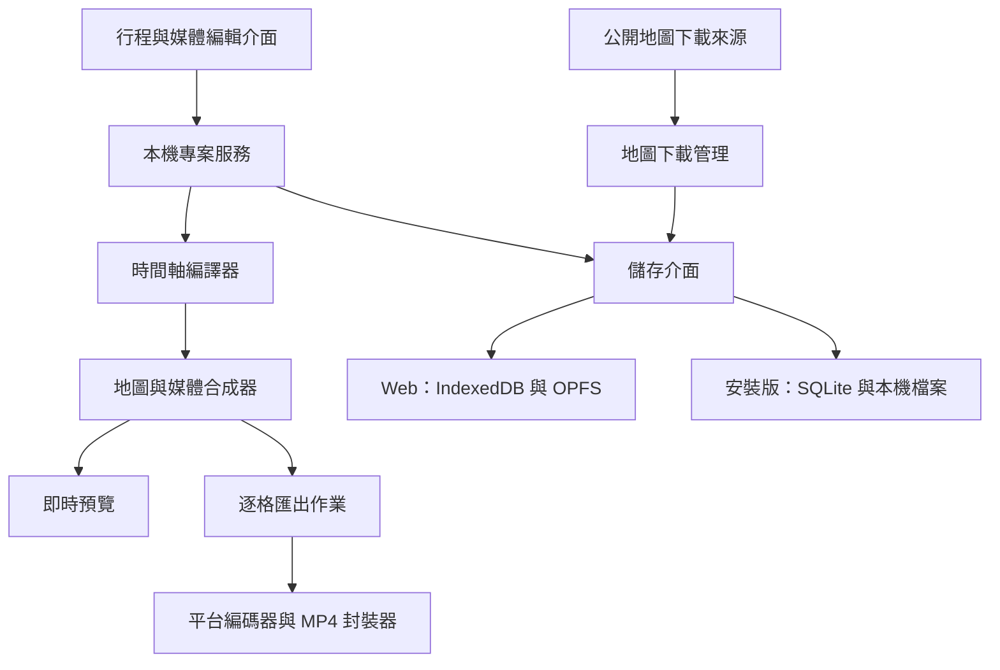

# TripReplay：產品規格與技術設計

[English](../specification.md) | 繁體中文

> 本文件為英文版之翻譯；如有歧異，以英文版為準。

| | |
|---|---|
| 版本 | 0.3（草案） |
| 日期 | 2026-10-24 |
| 狀態 | 設計階段。本文件中的技術候選項目尚未通過[授權審查](license-policy.md)。 |

> 1.0 版的範圍與品質標準定義於 [1.0 定義](release-1.0.md)。本規格描述長期的產品樣貌。
>
> [相依套件授權政策](license-policy.md)的效力優先於本文件。下列技術選型若與該政策牴觸，即暫停採用，直至找到符合政策的替代方案。

## 1. 概述

TripReplay 將規劃好的行程，以及旅途中拍攝的照片與影片，製作成動態旅行回顧。回顧內容以俯視地圖呈現，依序繪製景點間的路線動畫、拉近至各景點，並播放對應的媒體，最終匯出為影片檔。

### 1.1 目標

- 建立行程、匯入照片與影片，並依景點順序產生動態回顧。
- 將回顧匯出為影片檔。
- 支援 Web、Windows、macOS、Linux、Android 及 iOS。1.0 版發行 Web 版與 Android 應用程式（[ADR 0004](adr/0004-web-first-release.md)、[ADR 0008](adr/0008-android-in-1-0.md)）。
- 所有私人媒體與處理作業皆保留在裝置上。
- 完全在裝置上執行：使用者預先下載所需區域的地圖，之後編輯、地點搜尋、預覽及匯出皆不需要網路連線。本專案不營運任何伺服器（[ADR 0006](adr/0006-local-only-operation.md)）。

### 1.2 設計預設值

以下為第一版可調整的預設值，並非額外需求：

- 單人使用，無需帳號。
- 向量地圖，景點間以示意連線串接；單一影片軌；簡易交叉淡化轉場。
- 輸出：預設 MP4、1080p、30 fps，另提供 720p；橫式 16:9 與直式 9:16。

### 1.3 「私人資料保留在裝置上」之定義

原始照片、影片與音訊、EXIF 中繼資料、專案內容、縮圖、代理媒體及匯出影片，一律不傳送至遠端服務。

地點搜尋在裝置上針對已下載的地圖執行，因此搜尋字詞不會傳送至任何地方。唯一離開裝置的資訊是下載了哪些地圖區域，下載來源可以得知。區域範圍較大（例如一個國家），介面會在首次下載前說明此點。

## 2. 使用流程與畫面

1. **旅行列表** — 建立、開啟、重新命名、備份及刪除專案；顯示本機儲存空間用量與離線就緒狀態。
2. **行程編輯** — 依日期分組景點；於已下載的地圖中搜尋地名、手動標點，或貼上座標或地圖連結；調整順序；設定名稱與描述。支援多日行程、跨國行程及跨越國際換日線。
3. **媒體編輯** — 從本機檔案系統或系統相簿匯入；將媒體指派至景點；調整順序；裁剪影片；設定顯示時長、旋轉及填滿方式。GPS 與時間戳記配對僅作為建議；缺少中繼資料時改為手動指派。使用者可修正時區。
4. **日記** — 每個景點可寫一篇日記，每張照片或每段影片可寫一則簡短備註，並以日記的形式逐日閱讀。備註會成為該媒體在回顧中的說明文字。
5. **回顧預覽** — 地圖與媒體預覽；播放、暫停及拖曳時間軸；切換畫面比例。桌面版採側邊面板搭配底部時間軸；行動版採預覽畫面搭配分頁面板。
6. **出發前準備** — 估算儲存空間；下載所需地圖、字型及圖示；確認所有媒體皆已存於裝置；產生預覽用代理檔；列出缺少的項目。
7. **影片匯出** — 解析度、畫面比例、標題、原始音訊開關；匯出前檢查、進度顯示、取消、具體的錯誤說明，並透過作業系統儲存或分享。

### 2.1 回顧結構

開場總覽 → 路線逐段延伸 → 鏡頭移至景點並拉近 → 地點標題 → 照片與影片 → 拉遠並移往下一站 → 全程總覽與片尾。

### 2.2 預設時長

| 元素 | 時長 |
|---|---|
| 開場 | 3 秒 |
| 景點間移動 | 2 秒 |
| 景點標題 | 1 秒 |
| 照片 | 3 秒 |
| 影片 | 裁剪後長度 |
| 片尾 | 3 秒 |

轉場重疊由時間軸編譯器計算，而非單純加總各段時長。沒有媒體的景點仍顯示標題與地圖，絕不出現黑畫面。

## 3. 第一版範圍

1.0 版的範圍定義於 [1.0 定義 §4](release-1.0.md#4-功能)。1.0 交付畫面體驗——編輯、媒體匯入及預覽——並包含依 GPS 與拍攝時間的媒體自動配對、使用者自備的背景音樂，以及隨附主題。地圖依區域下載並在裝置上使用。MP4 匯出於下一個版本推出。

**延後至 1.0 之後：** 安裝版應用程式、逐路段道路導航、即時 GPS 追蹤、多人協作、雲端同步、雲端 AI 整理、3D 建築、衛星影像、4K／HDR 輸出、多軌剪輯及範本商店。靜態圖片匯出不在範圍內。

## 4. 離線運作與隱私

### 4.1 地圖下載

應用程式僅使用儲存於裝置上的地圖。使用者選擇區域（例如一個國家），並按一個按鈕下載。每個區域為一個 PMTiles 檔案，包含向量圖磚及搜尋所用的地名。地圖樣式與字型（含隨附的 CJK 字型）屬於應用程式的一部分。

- 下載前顯示大小與可用空間；下載後顯示各區域的已用空間。
- 以 HTTP 範圍請求分段下載，支援暫停、續傳、重試及完整性驗證。檔案須完整並通過驗證後才可使用（[技術驗證 S6](spikes/s6-web-storage.md)）。
- Web 無法可靠偵測網路類型，因此由使用者啟動下載；應用程式不宣稱可判斷網路類型。
- 使用者亦可開啟裝置上已有的地圖檔。
- 匯入時，原始媒體完整複製至應用程式管理的儲存區。雲端相簿中尚未下載至裝置的檔案，標示為無法使用。

### 4.2 區域狀態

`未下載` → `下載中` → `驗證中` → `已就緒`

其他狀態：`已暫停`、`空間不足`、`失敗`、`有可用更新`。更新下載期間，既有 `已就緒` 的區域仍可使用。

### 4.3 規則

- 編輯、地點搜尋、預覽及匯出皆不發出任何遠端請求。
- 景點位於已下載區域之外時，顯示明確提示並提供下載該區域；絕不阻擋編輯。
- 回顧所需的區域缺漏時阻擋匯出；絕不匯出空白地圖。
- 每次啟動及每次匯出前皆重新驗證就緒狀態，因為 Web 儲存空間可能遭瀏覽器清除。

下載來源的條款必須允許下載、本機儲存及用於匯出影片，並明定標示來源的要求。禁止從 OpenStreetMap 標準圖磚伺服器批次下載（[OSM 圖磚使用政策](https://operations.osmfoundation.org/policies/tiles/)）。

### 4.4 隱私預設

- 無遠端分析、無遠端媒體處理，亦不自動上傳當機附件。
- 日誌不記錄完整本機路徑、EXIF 資料或行程內容。
- 唯一的網路請求為載入應用程式，以及下載使用者選擇的地圖區域。地點搜尋在裝置上執行。
- 安裝版必須制定並於各平台驗證排除策略，避免敏感資料被作業系統自動備份至雲端。

## 5. 系統架構

建議架構以 React 與 TypeScript 共用 UI、資料模型及時間軸程式碼；Web 版採漸進式網頁應用程式（PWA）；五種安裝版平台以 Tauri 2 為候選外殼，並透過 Kotlin 與 Swift 外掛整合行動裝置原生功能（[Tauri 行動外掛](https://v2.tauri.app/develop/plugins/develop-mobile/)）。上述皆為有待技術驗證與授權審查的提案，並非所有平台皆已驗證。Tauri 未通過授權審查，1.0 的 Android 應用程式改用 Capacitor（[ADR 0008](adr/0008-android-in-1-0.md)）。

套件結構、分層與相依規則定義於[應用程式架構](architecture.md)，畫面則定義於[畫面設計](ui-design.md)。

### 5.1 主要取捨

Web 技術便於共用地圖與 UI，但大量影片資料跨越原生橋接層傳輸，可能成為效能瓶頸。原生編解碼外掛與共用合成器之間，應採用有界緩衝區並盡量減少複製；絕不以 Base64 透過 JavaScript IPC 逐格傳遞影格。若行動裝置驗證未達標，則保留領域模型與時間軸格式，改由行動原生管線負責渲染。此決策必須在大量投入 UI 開發之前做出。

地圖為區域 PMTiles 檔案，儲存於來源私有檔案系統（OPFS），並於本機隨機存取讀取。PMTiles 僅為容器格式，本身不代表取得任何資料權利，權利由下載來源的條款決定（[Protomaps 文件](https://docs.protomaps.com/)）。技術驗證 S1 已驗證可從依範圍讀取的 PMTiles 渲染；改從 OPFS 讀取而非 HTTP，存取方式相同。

## 6. 資料模型與持久化

| 實體 | 主要欄位 |
|---|---|
| Trip | id、schemaVersion、title、timezone、startDate、endDate、revision |
| Stop | id、tripId、order、date、name、longitude、latitude、description |
| Asset | id、contentHash、managedUri、type、duration、width、height、rotation、codec、captureTime、timezoneSource、optionalGPS、status |
| Clip | id、stopId、assetId、order、inUs、outUs、photoDurationUs、fit、volume |
| Timeline | version、sourceRevision、segments、cameraKeyframes、audioTracks、totalDurationUs |
| OfflinePack | id、resourceManifest、coverage、zoomRange、styleVersion、attribution、licenseRef、bytes、checksum、status |
| ExportJob | id、tripRevision、settings、state、progress、outputUri、errorCode |

### 6.1 慣例

- 所有時間軸數值皆以整數微秒表示。
- 地理座標採用 WGS 84，順序一律為經度、緯度。
- 照片、媒體與景點以 ID 關聯，絕不以檔名或可變動的順序作為識別。
- 刪除景點時，提示使用者如何處理其媒體。僅有未被任何專案引用的資產可被回收清理。

### 6.2 資料耐久性

- 安裝版使用資料庫交易，並先寫入暫存檔再以原子操作取代。
- Web 版以 IndexedDB 交易儲存 manifest；OPFS 檔案使用完成標記，避免引用到未完成的檔案。
- 匯入時以串流方式複製並計算內容雜湊值，以偵測重複檔案。
- 資料庫與檔案系統不共用原子交易；應用程式啟動時會掃描未完成的匯入並進行修復。

### 6.3 專案包

專案包包含版本化的 manifest、媒體及必要的授權資訊。預設包含原始媒體；可再散布的離線地圖為選用項目。封裝以串流方式進行，絕不將整個專案包載入記憶體。還原前會驗證雜湊值、格式版本、路徑穿越、檔案大小及可用空間，通過後才匯入。第一版在裝置間移轉專案須手動操作，不提供自動同步。

Web 版可請求持久化儲存並顯示配額，但無法保證資料不會遭清除；專案包為正式支援的備份機制（[MDN：Origin private file system](https://developer.mozilla.org/en-US/docs/Web/API/File_System_API/Origin_private_file_system)）。

## 7. 預覽與影片管線

時間軸編譯器將行程轉換為明確的區段、鏡頭關鍵影格及媒體區間。`renderAt(timeUs, settings)` 決定任一時間點的鏡頭、路線進度、字幕、媒體及透明度。預覽與匯出共用同一份定義；地圖函式庫的即時 `flyTo` 動畫絕不作為匯出的唯一依據。跨越國際換日線的路線採取合理的最短路徑，跨洲長程路段則調整總覽比例尺。

預覽可使用較低解析度的代理檔，並預先載入下一站。匯出時從原始媒體解碼，依 30 fps 的時間點逐格渲染。每一格皆待所需的圖磚、字型及媒體就緒後才進行編碼。音訊依時間軸獨立裁剪、重新取樣及混音，再封裝為 MP4。完整影片絕不全部存放於記憶體中；解碼、渲染及編碼各階段之間以有界佇列連接，並具備背壓機制。

### 7.1 輸入與輸出格式

基準輸入格式為 JPEG、PNG 及 H.264／AAC MP4。HEIC、HEVC、MOV、HDR 及可變影格率來源為必測輸入；依平台能力於本機轉換，或明確告知不支援。輸出以 SDR 為目標，須正確處理旋轉、色彩及影音同步。絕不以副檔名推斷編碼格式。

| 平台 | 編碼器設計 | 支援承諾 |
|---|---|---|
| Web | WebCodecs 搭配 MP4 封裝器；匯出前偵測音訊與視訊編碼器設定 | 於支援的瀏覽器與裝置上提供本機 MP4 匯出；不支援的環境會明確告知，並可備份專案後改由安裝版匯出 |
| Windows／macOS／Linux | 本機編碼服務，採用系統編碼器或其他符合授權政策的編碼器 | 發行前驗證 H.264、AAC、授權、封裝及硬體差異 |
| Android | Kotlin 外掛橋接原生編解碼與封裝管線 | 於實機驗證長片、溫度、記憶體及背景中斷 |
| iOS | Swift 外掛橋接原生編解碼與封裝管線 | 於實機驗證相簿素材、色彩、背景中斷及輸出 |

WebCodecs 的支援程度必須在實際裝置上檢查；能播放某種格式不代表能以該格式編碼（[MDN：Codec selection](https://developer.mozilla.org/en-US/docs/Web/API/WebCodecs_API/Codec_selection)）。

「跨平台」意指核心產品可在全部六類平台上使用，並不代表每個瀏覽器皆支援相同的輸出。若要保證所有瀏覽器皆可匯出 MP4，須另行驗證本機 WASM 編碼器的效能、儲存空間及授權，目前未納入承諾。

行動版第一版要求匯出期間維持於前景。若應用程式轉入背景或遭系統終止，匯出會安全中止並可重新開始；不承諾可無限期於背景執行。編輯內容持續自動儲存；匯出完成前僅存在暫存檔，確保毀損的檔案絕不會被呈現為完成的成品。

## 8. 內部介面與作業狀態

| 服務 | 操作 |
|---|---|
| `ProjectRepository` | `load`、`save(expectedRevision)`、`list`、`delete`、`recover` |
| `AssetService` | `import`、`inspect`、`createProxy`、`resolve`、`verify`、`removeUnreferenced` |
| `OfflineService` | `plan(tripRevision, viewport, style)`、`download`、`pause`、`resume`、`verify`、`remove` |
| `TimelineCompiler` | `compile(project, settings)` → 不可變的時間軸 |
| `RenderEngine` | `prepare(timeline)`、`renderAt(timeUs)`、`release` |
| `ExportService` | `capabilities`、`preflight`、`start`、`cancel`、`status` |

- 所有長時間作業皆回傳 `jobId`。進度事件包含 `phase`、`completed`、`total` 及 `errorCode`；時間估計與進度分開回報。
- 匯出階段：準備 → 解碼與渲染 → 編碼與封裝 → 驗證 → 完成。失敗或取消時，清除所有可重建的暫存檔。
- 下載重試以資源雜湊值與版本去除重複。
- 匯出時鎖定專案修訂版本，避免使用者同時編輯而改變輸出內容。

本專案不營運任何後端或地圖服務。私人資料絕不離開裝置；地圖區域從公開來源下載。

## 9. 驗收標準與測試

以下為建議目標，尚未實際量測。技術驗證階段將記錄參考裝置的確切型號、作業系統、瀏覽器及記憶體，再據以訂定正式門檻。

| 情境 | 通過條件 |
|---|---|
| 完整流程 | 含 10 個景點、50 張照片及 10 段短片的旅行，可建立、編輯、儲存、重新開啟並匯出 |
| 飛航模式 | 下載地圖後，於離線狀態重新啟動應用程式；編輯、地點搜尋、預覽及匯出皆可完成，且無任何遠端請求 |
| 網路隱私 | 檢查所有請求，皆不含私人媒體、EXIF 資料、專案內容或本機路徑 |
| 區域缺漏 | 景點位於已下載區域之外時提示下載該區域；不完整的檔案絕不標示為已就緒 |
| 影片正確性 | 順序、裁剪、旋轉、字幕及片長皆正確；影音偏差目標不超過 100 ms |
| 畫面可重現 | 相同時間點的構圖與媒體在多次執行間一致；不要求跨 GPU 像素完全相同 |
| 互動效能 | 預覽以 30 fps 為目標，負載過高時可降低畫質；記錄掉格率及記憶體峰值 |
| 大量媒體 | 以串流方式處理總量 10 GB、含 4K 來源的媒體，不致耗盡記憶體 |
| 當機復原 | 於匯入、下載或匯出期間強制結束後，專案仍可開啟，且不會誤報成功 |
| 跨平台專案 | 在六類平台間交換專案包，保留順序、裁剪、座標、時間及媒體 |
| 異常輸入 | 缺少 GPS、時區錯誤、無媒體的景點、無音軌片段、毀損檔案及磁碟已滿，皆有明確結果 |
| 地圖邊界 | 跨換日線、相同座標、多國及長距離路線，皆無錯誤環繞或不合理的縮放 |

Web 版測試 Chrome、Edge、Firefox 及 Safari 的支援範圍；安裝版逐一於 Windows、macOS、Linux、Android 及 iOS 測試。最低作業系統與瀏覽器版本於編解碼實測後才確定，不預先宣稱全面支援。

## 10. 開發階段與決策關卡

| 階段 | 範圍 |
|---|---|
| A | 以同一段短時間軸，在六類平台上完成地圖渲染、本機檔案存取、影片解碼及 30 秒 MP4 匯出；驗證 iOS 與 Android 的橋接效能。若未通過此關卡，須先調整原生管線或支援範圍。 |
| B | 完成行程、媒體、本機儲存與預覽的完整流程；建立版本化專案包。 |
| C | 地圖下載、續傳下載、配額管理、裝置上的地點搜尋，以及實際斷網的驗收測試。屬於 1.0 範圍（[ADR 0006](adr/0006-local-only-operation.md)）。 |
| D | 各平台匯出、音訊、取消與復原；測試長片、低儲存空間及各種輸入格式。 |
| E | 平台封裝、程式碼簽署、權限、無障礙及發行準備。iOS 的建置與測試需要 macOS、Xcode 及實機；在 Windows 開發環境成功不能取代之（[Tauri 建置前置需求](https://v2.tauri.app/start/prerequisites/)）。 |

目前尚未估算固定時程；人力及測試裝置仍未確定。最大的風險在於影片管線與地圖授權，而非畫面數量。

## 11. 待決事項

下列事項不影響本版設計：

- 1.0 之後各安裝版平台的發行順序。

已由 [1.0 定義](release-1.0.md)決定：地圖資料來源（§5）、瀏覽器支援與參考目標（§3、§6），以及背景音樂與媒體自動配對是否納入（§4.2）。其 §7 列出 1.0 仍待決的事項。

隨專案成長再行評估：跨專案去除重複、代理檔快取清理、4K／HDR，以及原生渲染效能。任何未來的同步或雲端功能，皆須重新進行隱私審查，且不得預設啟用。
