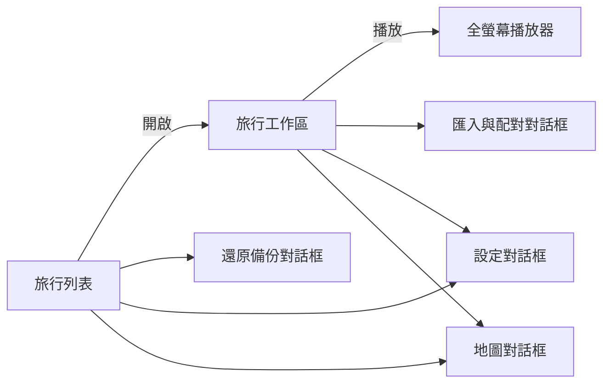

# 畫面設計

[English](../ui-design.md) | 繁體中文

> 本文件為英文版之翻譯；如有歧異，以英文版為準。

| | |
|---|---|
| 版本 | 0.2（草案） |
| 日期 | 2026-10-24 |
| 狀態 | 設計。描述 1.0 版的畫面（[1.0 定義](release-1.0.md)）。 |

## 1. 結構

1.0 版共有三個畫面與少數對話框：



編輯與預覽共用**同一個工作區**，任何變更皆可立即看到，無需切換畫面。

## 2. 旅行列表

- 以卡片格狀排列旅行。每張卡片顯示由旅行片尾總覽渲染的路線縮圖、旅行名稱、日期、景點數及儲存空間用量。
- 每張卡片的「⋯」選單：重新命名、複製、備份、刪除。
- 標題列與最後一張卡片皆提供「新增旅行」。
- 尚無旅行時，僅顯示一個行動呼籲：「建立第一趟旅行」。
- 頁首提供「地圖」、「還原備份」與「設定」。

### 2.1 地圖對話框

地圖下載一次後即在裝置上使用（[ADR 0006](adr/0006-local-only-operation.md)）。

- 區域列表（例如各國），各自顯示大小與狀態：未下載、下載中（含進度）、已就緒（含已用空間），或有可用更新。
- 每個區域一個按鈕：「下載」、「暫停」或「繼續」、「更新」、「刪除」。開始下載前顯示大小與可用空間。
- 「開啟地圖檔」可加入裝置上已有的地圖檔。
- 首次使用時，以及景點位於已下載區域之外時，應用程式會開啟此對話框並預先選取對應的區域。
- 附註說明下載來源可得知下載了哪些區域，除此之外一無所知。

## 3. 旅行工作區

### 3.1 桌面版版面

```
┌──────────────────────────────────────────────────────────────┐
│ ← 旅行名稱                   [16:9 | 9:16]  [▶ 播放]  [⚙]    │
├──────────────────┬───────────────────────────────────────────┤
│ 行程│媒體│音樂│主題 │                                           │
│                  │              預覽                         │
│ 第 1 天 · 4/1     │                                           │
│  ① 京都車站   ⠿  │                                           │
│  ② 伏見稻荷   ⠿  │                          地圖來源標示       │
├──────────────────┴───────────────────────────────────────────┤
│ ▶  00:42 / 03:10                                             │
│ 開場│→│標題│照片│照片│→│標題│影片│ … │片尾                      │
│ ♪ 背景音樂 ════════════════════════════                       │
└──────────────────────────────────────────────────────────────┘
```

- **側邊面板**（寬 320 px）含四個分頁，見 §3.3。
- **預覽**依所選畫面比例填滿其餘區域。
- **時間軸**橫跨底部全寬。

### 3.2 手機版版面

寬度小於 820 px 時，相同的區塊改為垂直堆疊：預覽（約占螢幕高度一半，9:16 時更多）、時間軸，接著是分頁面板。不隱藏任何功能，僅改變排列方式。

### 3.3 側邊面板分頁

| 分頁 | 內容 |
|---|---|
| 行程 | 依日期分組的景點，各附編號、名稱及媒體數量。拖曳把手即可排序，亦可跨日移動。選取景點時，預覽移至該景點。可透過搜尋已下載地圖中的地名、「在地圖上標點」，或貼上座標或地圖連結（例如來自 Google Maps）新增景點。 |
| 媒體 | 「匯入媒體」按鈕；依序顯示所選景點的媒體縮圖。選取照片時顯示其時長；選取影片時顯示裁剪控制與音量。 |
| 音樂 | 已匯入的音軌；淡入、淡出，以及「有聲片段時自動降低音樂」；音量。 |
| 主題 | 附小型預覽的主題卡片；選取後立即套用。選擇直式主題時，預覽亦切換為 9:16。 |

### 3.4 時間軸

- 一列依序排列的區段：開場、移動（→）、景點標題、照片、影片、片尾。寬度與時長成正比，以顏色區分類型。
- 另一列顯示背景音樂，在有聲片段處以較深的區塊標示降低音量的範圍。
- 點擊或拖曳時間軸即可移動播放頭；空白鍵切換播放。
- **以拖曳方式編輯時長：**

| 區段 | 拖曳行為 |
|---|---|
| 照片 | 拖曳右緣調整時長，以 0.5 秒為單位，範圍 1 至 15 秒 |
| 影片 | 拖曳任一邊緣裁剪起點或終點，不超過片段長度 |
| 音樂 | 拖曳片段可移動位置；拖曳任一端可裁剪 |
| 開場、移動、標題、片尾 | 1.0 版由主題固定 |

- 每次變更皆為單一命令，可以復原。
- 所選景點的區段會醒目顯示；選取區段時，側邊面板同步選取其景點與媒體。

## 4. 匯入與配對對話框

1. 使用者選取檔案；進度列顯示中繼資料的讀取進度。
2. **建議配對**列出每個項目的拍攝時間，以及下拉選單中的建議景點。每項建議皆須個別接受或以「全部接受」確認；不會自動套用。
3. **無法判斷**列出缺少 GPS 資料或拍攝時間的項目，各附景點選擇器供手動指派。
4. 顯示旅行的**時區**並提供「修改」，可一次修正相機時間設定錯誤的所有項目。
5. 「完成匯入」加入已接受及手動指派的項目；「取消」則不加入任何項目。

## 5. 全螢幕播放器

- 僅顯示回顧畫面，依所選畫面比例置於黑色背景中。
- 控制列（播放或暫停、進度、時間、離開）在指標 2.5 秒未移動後淡出，移動時再次出現。
- 按 Esc 離開。地圖來源標示全程可見。

## 6. 回顧內容

| 階段 | 預設時長 | 觀看者所見 |
|---|---|---|
| 開場 | 3 秒 | 整趟旅行的總覽，標示所有景點；旅行名稱與日期淡入 |
| 移動 | 2 秒 | 鏡頭飛往下一個景點，長距離時會先拉遠；路線沿途逐步繪出 |
| 景點標題 | 1 秒 | 鏡頭停在景點上；顯示名稱與日期 |
| 照片 | 每張 3 秒 | 地圖上出現帶框的照片並緩慢推近；景點名稱保留於角落 |
| 影片 | 裁剪後長度 | 帶框的影片，含原始音訊與進度列 |
| 片尾 | 3 秒 | 鏡頭回到總覽並呈現完整路線；旅行摘要淡入 |

啟用「減少動態效果」時，鏡頭移動與推近效果改以交叉淡化取代。

## 7. 主題

| 主題 | 外觀 | 適用情境 |
|---|---|---|
| 經典 | 淺色地圖、深紅色路線、帶陰影的白色標題 | 一般用途，16:9 |
| 夜間 | 深色地圖、發光的黃色路線 | 夜間觀看與投影 |
| 直式 | 大標題置頂、媒體位於下半部 | 以 9:16 在手機上分享 |

應用程式介面本身依系統的淺色或深色設定顯示，與回顧主題無關。

## 8. 無障礙

- 所有操作皆可透過鍵盤完成：分頁、景點清單、時間軸（方向鍵移動播放頭並調整聚焦區段的時長）、對話框。
- 拖放操作皆有鍵盤替代方式：景點可上移或下移，區段可輸入時長。
- 每個控制項皆有螢幕閱讀器標籤；預覽會朗讀目前景點。
- 兩種介面配色皆符合 WCAG 2.2 AA 對比度要求。
