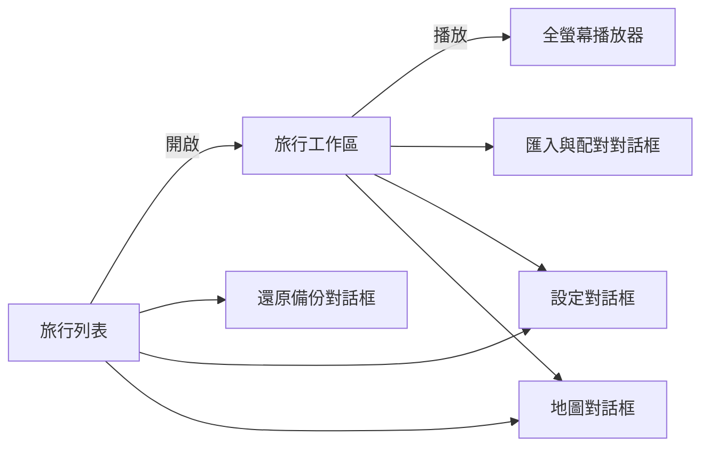

# 畫面設計

[English](../ui-design.md) | 繁體中文

> 本文件為英文版之翻譯；如有歧異，以英文版為準。

| | |
|---|---|
| 版本 | 0.2（草案） |
| 日期 | 2026-10-24 |
| 狀態 | 設計。描述 1.0 版的畫面（[1.0 定義](release-1.0.md)）。 |

## 1. 結構

1.0 版共有三個畫面與少數對話框：



編輯與預覽共用**同一個工作區**，任何變更皆可立即看到，無需切換畫面。

## 2. 旅行列表

- 以卡片格狀排列旅行。每張卡片顯示由旅行片尾總覽渲染的路線縮圖、旅行名稱、日期、景點數及儲存空間用量。
- 每張卡片的「⋯」選單：重新命名、複製、備份、刪除。
- 標題列與最後一張卡片皆提供「新增旅行」。
- 尚無旅行時，僅顯示一個行動呼籲：「建立第一趟旅行」。
- 頁首提供「旅行」、「地圖」與「設定」；旅行列表提供「還原備份」，每張卡片提供「備份」。備份為單一專案包檔案（[專案包格式](project-package.md)）；瀏覽器支援時會直接寫入所選的檔案。若備份中的旅行已在本裝置上，可還原為副本。「**備份**」會詢問「**原尺寸**」或「**縮小照片**」，並提供「**也縮小影片**」核取方塊；選擇縮小時，備份中放入使用新資產 ID 的副本，裝置上的旅行不會變更。每張卡片也提供「**縮小媒體**」：先顯示照片與影片的數量及所占空間，提供「**也縮小影片**」，並請使用者確認，執行時顯示進度，完成後顯示縮小前後的空間（[ADR 0011](adr/0011-smaller-media.md)）。

### 2.1 地圖對話框

地圖下載一次後即在裝置上使用（[ADR 0006](adr/0006-local-only-operation.md)）。

- 區域列表（各國，或大國的各部分），各自顯示大小與狀態：未下載、下載中（含進度）、已就緒（含已用空間），或有可用更新。
- 「國家或地區」下拉選單決定列出哪些區域：「**熱門國家**」（預設）、「**收藏**」、「**已下載**」、「**目前位置**」，接著是各國家；熱門國家在前，其餘列於「更多國家」下，依該語言的排序方式排列。
- 每個區域旁的星號可將其加入收藏；收藏會記在瀏覽器中。
- 「使用目前位置」會以低精確度讀取一次裝置位置，並列出包含該位置的區域；位置只在裝置上使用。只有瀏覽器支援定位時才會提供。未取得權限或無法取得位置時，列表會說明原因。
- 每個區域一個按鈕：「下載」、「暫停」或「繼續」、「更新」、「刪除」。開始下載前顯示大小與可用空間。
- 「開啟地圖檔」可加入裝置上已有的地圖：一併開啟 Overture Maps 的 base、transportation 與 divisions 主題 PMTiles 檔，若需要景點則另加 places。檔案會複製到儲存空間；該區域以其 base 檔案名稱列出，只能刪除，無法更新。
- 首次使用時，以及景點位於已下載區域之外時，應用程式會開啟此對話框並預先選取對應的區域。
- 附註說明下載來源可得知下載了哪些區域，除此之外一無所知。

## 3. 旅行工作區

### 3.1 桌面版版面

```
┌──────────────────────────────────────────────────────────────┐
│ ← 旅行名稱                   [16:9 | 9:16]  [▶ 播放]  [⚙]    │
├──────────────────┬───────────────────────────────────────────┤
│ 行程│媒體│音樂│主題 │                                           │
│                  │              預覽                         │
│ 第 1 天 · 4/1     │                                           │
│  ① 京都車站   ⠿  │                                           │
│  ② 伏見稻荷   ⠿  │                          地圖來源標示       │
├──────────────────┴───────────────────────────────────────────┤
│ ▶  00:42 / 03:10                                             │
│ 開場│→│標題│照片│照片│→│標題│影片│ … │片尾                      │
│ ♪ 背景音樂 ════════════════════════════                       │
└──────────────────────────────────────────────────────────────┘
```

- **側邊面板**（寬 320 px）含四個分頁，見 §3.3。
- **預覽**依所選畫面比例填滿其餘區域。
- **時間軸**橫跨底部全寬。

### 3.2 手機版版面

寬度小於 820 px 時，相同的區塊改為垂直堆疊：預覽（約占螢幕高度一半，9:16 時更多）、時間軸，接著是分頁面板。不隱藏任何功能，僅改變排列方式。

在所有版面中，使用者點選的項目都會留在原處：點選或選擇後，若其上方有內容展開或收起（例如景點的操作列），或其下方的頁面變短（例如行程只顯示一天、時間軸下方的欄位），頁面會依該項目移動的距離捲動。頁面變得太短時保留在底部的空間，會隨使用者往上捲動而收回。對話框、可自行捲動的區域，以及刻意將項目捲入視野的動作，則維持原樣。頁面會關閉瀏覽器內建的捲動錨定，因為它固定的是其他元素（常是所選項目下方的元素），而非所選項目。

### 3.3 側邊面板分頁

| 分頁 | 內容 |
|---|---|
| 行程 | 依日期分組的景點，各附編號及名稱。標題旁的「排序」按鈕會在每個景點顯示拖曳把手，避免誤觸而改變順序；開啟期間按鈕顯示「完成」，再按一次即關閉。拖曳把手即可排序，亦可跨日移動，並以線條標示放置位置。有多天時，以標籤（「全部」、「第 1 天」…）一次顯示一天，選擇某天也會設定新景點的日期。選取景點時，預覽移至該景點，並在其下方展開操作：「媒體（n）」與「日記」開啟該分頁並定位到此景點，接著是複製、重新命名、移除、上移與下移，後兩者供鍵盤操作。可透過搜尋已下載地圖中的地名、「在地圖上標點」，或貼上座標或地圖連結（例如來自 Google Maps）新增景點。名稱相符、已在本行程中的地點會優先列於搜尋結果，並標示「本行程」。「複製」會開啟小表單，選擇副本的日期與位置：那天最前面或某個景點之後（同一天預設在原景點之後，其他天預設在最後一個景點之後），適用於連住多晚的飯店或再次經過的車站；副本不含日記。 |
| 媒體 | 「匯入媒體」按鈕；依日期分組的「景點」清單可選擇要顯示哪個景點的媒體；依序顯示該景點的媒體縮圖。「**匯入時縮小照片**」核取方塊（在關閉前保持開啟）與「**匯入時縮小影片（1080p，較慢）**」核取方塊（在開啟前保持關閉，且只在瀏覽器能編碼影片時顯示）決定匯入時是否儲存縮小副本；兩者都保存在瀏覽器中（[ADR 0011](adr/0011-smaller-media.md)）。選取照片時顯示其時長與「途中」核取方塊（§6）；選取影片時顯示裁剪控制與音量。開啟「匯入媒體」旁的「排序」後，拖曳項目的把手（⠿）即可排序。每個項目的「編輯」按鈕會展開一列：依日期分組的「移到…」清單（移到其他景點的媒體最後）、上移、下移（供鍵盤操作）及從景點移除。 |
| 日記 | 以日記形式逐日呈現整趟旅行，並有與行程相同的天數標籤，可一次顯示一天（從其他地方開啟的景點會切換到其所在的那天）：每一天有一句最多 200 字的開場文字，於回顧中這天開始時顯示；每個景點附其日記，每張照片或每段影片附一則簡短備註（最多 500 字），備註會成為其說明文字。欄位失去焦點，或按下 Ctrl+Enter 或 Cmd+Enter 時，該篇內容會以一次可復原的變更儲存。選取景點名稱時，預覽移至該景點。 |
| 音樂 | 已匯入的音軌；淡入、淡出，以及「有聲片段時自動降低音樂」；音量。 |
| 主題 | 附小型預覽的主題卡片；選取後立即套用。選擇直式主題時，預覽亦切換為 9:16。 |

### 3.4 時間軸

- 一列依序排列的區段：開場、移動（→）、景點標題、照片、影片、片尾。寬度與時長成正比，以顏色區分類型。
- 另一列顯示背景音樂，在有聲片段處以較深的區塊標示降低音量的範圍。
- 區段上方的刻度標示時間，間隔為 1、2、5、10、15、30 秒或更長，畫面中最多八個刻度。
- **縮放：** 時間軸上方的 − 與 + 按鈕可將其寬度減半或加倍，範圍從整段回顧到 5 秒佔滿寬度；只有長度足以縮放的回顧才會顯示這兩個按鈕。放大後的時間軸可左右滑動捲動，下方的總覽列顯示整段回顧，並以可拖曳的視窗標示目前可見的部分；點擊視窗旁也可移動視窗。縮放時，播放頭在畫面中的位置保持不變；播放期間，時間軸會捲動以保持播放頭可見。
- 點擊或拖曳時間軸即可移動播放頭；空白鍵切換播放。
- **逐段移動：** 時間軸上方的「« 上一天」、「‹ 上一段」、「下一段 ›」與「下一天 »」會把播放頭移到該段落稍後一點的位置並選取它，使其數值顯示於下方，不必瞄準細窄的區段。一天從前往當天第一個景點的移動開始；第一天從開場開始。段落從目前選取的段落起算，未選取時從播放頭所在的段落起算。
- **以拖曳方式或數字編輯時長：**

| 區段 | 拖曳行為 |
|---|---|
| 照片 | 拖曳右緣調整時長，以 0.5 秒為單位，範圍 1 至 15 秒 |
| 影片 | 拖曳任一邊緣裁剪起點或終點，不超過片段長度 |
| 音樂 | 拖曳片段可移動位置；拖曳任一端可裁剪 |
| 開場、移動、標題、片尾 | 不可拖曳；以數字為整趟旅行設定，範圍 0.5 至 15 秒，以 0.5 秒為單位。景點標題與移動到該景點也可單獨設定長度 |

- 點擊區段時也會選取它：時間軸下方的面板會顯示其名稱、起點與終點，並以秒數提供其數值——照片的時長、影片的起點與終點、音樂的開始時間，或整趟旅行該階段的長度。選取景點標題或移動時，上方另有欄位只設定該景點的長度（「此景點標題」、「移動到此景點」）；它會取代整趟的長度，以及因日記或當天開場文字而自動延長的長度，選取「改回整趟設定」即可移除。欄位失去焦點或按 Enter 時套用數值。「**關閉**」可隱藏面板。
- 時間軸上方一列開頭的「**重設時間間隔**」會以單一命令，將開場、移動、景點標題與結尾長度恢復為主題預設，並將每張照片恢復為 3 秒；影片剪輯、音樂與每日開場文字不變。
- 每次變更皆為單一命令，可透過工作區列中儲存狀態旁的「**復原**」與「**重做**」按鈕，或 Ctrl+Z 與 Ctrl+Shift+Z 復原與重做。沒有可復原或重做的變更時，按鈕會停用。
- 瀏覽器提供 WebMCP 時，其後會顯示「**AI 代理**」切換按鈕。按下後，會透過讀取旅行及編輯其文字的工具，將開啟中的旅行提供給瀏覽器的 AI 代理（[ADR 0010](adr/0010-agent-tools.md)）；代理所做的每項變更同樣是一個可復原的步驟。在使用者按下之前保持關閉，且此選擇會保存在瀏覽器中。
- 網頁應用程式的「**MCP**」切換按鈕會將開啟中的旅行連線到電腦上的 TripReplay MCP server（[ADR 0012](adr/0012-mcp-server.md)）。按下後，列下方會出現一列，先詢問代理顯示的配對碼，再顯示 TripReplay 正在等待 server、已連線、被拒絕或已由其他視窗接手，並提供「**變更配對碼**」。在使用者按下之前保持關閉。
- 所選景點的區段會醒目顯示；選取區段時，側邊面板同步選取其景點與媒體。

## 4. 匯入與配對對話框

1. 使用者選取檔案；進度列顯示中繼資料的讀取進度。
2. **建議配對**列出每個項目的拍攝時間，以及下拉選單中的建議景點。每項建議皆須個別接受或以「全部接受」確認；不會自動套用。
3. **無法判斷**列出缺少 GPS 資料或拍攝時間的項目，各附景點選擇器供手動指派。若從「媒體」分頁中選取的景點開始匯入，所有項目都會預設為該景點並視為已選定；建議不同的項目會提供「改用建議」，可一鍵改到建議的景點。
4. 顯示旅行的**時區**並提供「修改」，可一次修正相機時間設定錯誤的所有項目。
5. 「完成匯入」加入已接受及手動指派的項目；「取消」則不加入任何項目。

## 5. 全螢幕播放器

- 僅顯示回顧畫面，依所選畫面比例置於黑色背景中。
- 控制列（播放或暫停、進度、時間、離開）在指標 2.5 秒未移動後淡出，移動時再次出現。
- 按 Esc 離開。地圖來源標示全程可見。

### 5.1 匯出對話框

預覽下方的「匯出影片」會開啟對話框（[ADR 0009](adr/0009-export-in-1-0.md)）：

1. **畫質**：1080p（較清晰）或 720p（較快、檔案較小），畫面比例與旅行相同。**檔案大小**：較大（1080p 約 12 Mbit/s）、標準（約 8 Mbit/s）或較小（約 4 Mbit/s），並顯示影片的預估大小。對話框會探測編碼器，並說明將產生的格式（例如「H.264 影像與 AAC 聲音」）、無聲音編碼器時影片將沒有聲音，或此瀏覽器無法匯出。
2. 「開始匯出」會顯示進度：先混音，再以進度列顯示「正在繪製畫面 n／N」。「取消」會停止匯出並刪除未完成的檔案。附註提醒應用程式需保持在前景；切到背景時匯出會停止並說明原因。
3. 完成後，對話框顯示檔案大小與「儲存影片」，會開啟儲存對話框、下載資料夾，或 Android 應用程式中的系統儲存畫面。關閉對話框時會刪除暫存檔（無論是否已儲存）。

匯出使用開啟對話框當下的回顧；期間所做的編輯不會改變匯出結果。

## 6. 回顧內容

| 階段 | 預設時長 | 觀看者所見 |
|---|---|---|
| 開場 | 3 秒 | 整趟旅行的總覽，標示所有景點；旅行名稱與日期淡入 |
| 移動 | 2 秒 | 鏡頭飛往下一個景點，長距離時會先拉遠；路線沿途逐步繪出。前往新一天的第一個景點前，畫面會如入夜般變暗再轉亮，並在中央顯示天數（「第 2 天」）與日期，下方以日記明體顯示日記中這天的開場文字。有開場文字的一天（包括第一天）會延長其移動時間以便閱讀：至少 2 秒加上每字 0.12 秒，最長 8 秒 |
| 景點標題 | 1 秒，有日記時較長 | 鏡頭停在景點上；顯示名稱與日期，並以主題的日記明體、最多三行置中顯示日記的前 80 個字，背後襯以柔和的暗色光暈。日期與日記之間有一道細線，在景點標記處斷開（或在中央顯示路線顏色的菱形），各行依序浮現，並在標題的前半段內全部出現。標題至少停留 1.5 秒加上日記每字 0.12 秒，最長 10 秒 |
| 途中照片 | 每張 3 秒，於移動期間 | 在「媒體」分頁勾選「途中」的照片，會在前往其景點的移動期間顯示，而非在景點標題之後；每張以小卡片顯示在路線旁（16:9 為右下，9:16 為下方中央）並附上備註，依序淡入淡出，前後與彼此之間留有只有路線的片刻。移動時間會延長以容納這些照片，即使超過該段自訂的長度。照片有位置資訊時，路線會依景點媒體的順序轉折經過拍攝地點，並在該照片顯示期間抵達該點；沒有位置資訊時，路線在移動期間平均繪出。影片無法設為途中 |
| 照片 | 每張 3 秒 | 地圖上出現帶框的照片並緩慢推近，其備註以日記明體、最多兩行置中顯示於照片下緣，背後是往下漸深的陰影，並在照片出現後不久浮現；景點名稱保留於角落 |
| 影片 | 裁剪後長度 | 帶框的影片，含原始音訊、與照片相同方式顯示於畫面上的備註，以及進度列 |
| 片尾 | 3 秒 | 鏡頭回到總覽並呈現完整路線；旅行摘要淡入 |

除非旅行另行設定（§3.4），開場、移動、景點標題與結尾的長度由主題決定。

啟用「減少動態效果」時，鏡頭移動與推近效果改以交叉淡化取代，日記與備註也只淡入而不上浮。預覽下方的「**減少動態效果**」按鈕預設依照系統設定，並在瀏覽器中保留使用者的選擇。

## 7. 主題

| 主題 | 外觀 | 適用情境 |
|---|---|---|
| 經典 | 淺色地圖、深紅色路線、帶陰影的白色標題 | 一般用途，16:9 |
| 夜間 | 深色地圖、發光的黃色路線 | 夜間觀看與投影 |
| 直式 | 大標題置頂、媒體位於下半部 | 以 9:16 在手機上分享 |

應用程式介面本身依系統的淺色或深色設定顯示，與回顧主題無關。

## 8. 無障礙

- 所有操作皆可透過鍵盤完成：分頁、景點清單、時間軸（方向鍵移動播放頭並調整聚焦區段的時長）、對話框。
- 拖放操作皆有鍵盤替代方式：景點可上移或下移，區段可輸入時長。
- 每個控制項皆有螢幕閱讀器標籤；預覽會朗讀目前景點。
- 兩種介面配色皆符合 WCAG 2.2 AA 對比度要求。
